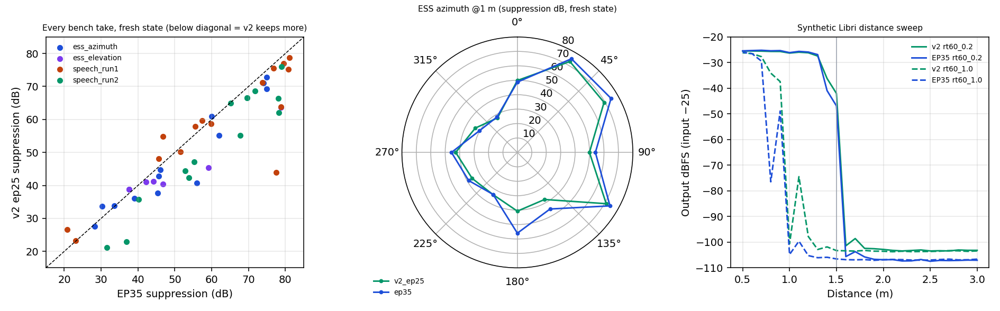

# v2 (epoch 25 best.pt) vs EP35: synthetic + bench sweep comparison

**Date:** 2026-11-04
**Candidate:** `runs/optim_finetune_ep24_ep35prog_synreal_lean_v2_from_ep24/checkpoints/best.pt`, **epoch 25** (training still running; `last.pt` was epoch 27 at evaluation time). Copied unchanged (sha256 `6631e16e…`) to the eval folder and exported to ONNX: opset 9, `onnx.checker` OK, Torch↔ORT equivalence OK over 5 frames.
**Baseline:** `edge/zoo/optim_sonitude_dist_count_1_5m_ep35.onnx`
**Eval folder:** `runs/_eval_v2_ep25_vs_ep35_20261104/` · figure `docs/img/eval_v2_ep25_vs_ep35_20261104/v2_ep25_vs_ep35.png`

## Method

1. **Synthetic sweep:** `scripts/distance_sweep_dbfs_onnx.py` (LibriSpeech talker, 0.5–3.0 m in 0.1 m steps, RT60 0.2/0.8/1.0/1.6 s, mic 0 at −25 dBFS), run identically on both ONNX models.
2. **Bench sweep:** all 48 real bench takes replayed offline through the C++ runtime from a **fresh state**, with each take's recorded input gain, mic gains and channel map. Only the model differs (`debug/eval_models_on_bench.py`). The 0°/0° repeat counts in both ESS sets, so there are 49 rows:
   - ESS azimuth sweep @ 1 m (14 rows)
   - ESS elevation set (6)
   - speech run 1 (15)
   - speech run 2: elevation × 0.5 / 1.0 / 1.5 m (14)

   Every source is inside or at the 1.5 m bubble, so **lower suppression = better**.

## Results

### Synthetic distance sweep (output dBFS, input −25)

| Distance | RT60 0.2 v2 / EP35 | RT60 0.8 v2 / EP35 | RT60 1.0 v2 / EP35 |
|---:|---:|---:|---:|
| 0.5 m | −25.5 / −25.4 | −25.9 / −25.6 | −26.2 / −25.9 |
| 0.8 m | −25.6 / −25.4 | −28.4 / −30.4 | **−34.1 / −76.5** |
| 1.0 m | −26.3 / −26.1 | −100.3 / −104.6 | −100.6 / −104.8 |
| 1.2 m | −26.2 / −25.9 | −88.2 / −102.8 | −97.8 / −105.2 |
| 1.4 m | −36.2 / −40.9 | −100.7 / −105.5 | −101.8 / −105.9 |
| 1.5 m | −42.0 / −46.9 | −103.2 / −106.5 | −103.3 / −106.5 |
| 2.0 m | −102.8 / −106.8 | −103.5 / −106.9 | −103.5 / −106.8 |
| 3.0 m | −103.2 / −107.0 | −103.3 / −106.6 | −103.4 / −106.6 |

- **Dry:** same passband and the same 1.4–1.6 m edge; v2 is about 5 dB less suppressive right at the edge.
- **Reverb:** v2 keeps reverberant speech better at 0.8 m (RT60 1.0: −34 vs −77 dB), but both still collapse in reverb from about 1 m out.
- **Far field:** both reject far talkers; EP35 goes about 4 dB deeper (−107 vs −103 dBFS).

### Bench takes (suppression in dB, fresh state)

| Set | n | v2 median | EP35 median | Median Δ (v2 − EP35) | v2 better (> 2 dB) | EP35 better (> 2 dB) |
|---|---:|---:|---:|---:|---:|---:|
| ESS azimuth 1 m | 14 | 41.7 | 45.9 | −2.5 | 8 | 1 |
| ESS elevation 1 m | 6 | 41.1 | 45.5 | −4.7 | 4 | 0 |
| Speech run 1 (0°/+30°/+60°) | 15 | 58.7 | 59.8 | −1.2 | 6 | 5 |
| Speech run 2 (elev × 0.5/1.0/1.5 m) | 14 | 58.7 | 66.4 | **−8.3** | 13 | 0 |
| **All** | **49** | | | **−2.9** | **31** | **6** |

**Largest v2 gains:**
- below the array: el −60° ESS 63.7 vs 78.8; speech 1 m −60° 62.1 vs 78.2; speech 0.5 m −60/−30° −12 dB
- above: el +60° ESS 45.4 vs 59.1; speech 1 m +60° 23.0 vs 36.9
- straight ahead: speech 0.5 m 0° 21.1 vs 31.6; 1 m 0° 42.3 vs 53.9
- az 180° ESS 40.7 vs 56.0

**Speech, median keep per band** (100-300 … 8-11k Hz):
- v2: −49 −43 −38 −33 −29 −26 −29
- EP35: −60 −51 −47 −47 −37 −34 −47

So v2 keeps 8–18 dB more in every band, and its residue is less tilted towards the highs (8–11 kHz −29 vs −47).

## Observations

1. **v2 is a modest but consistent improvement over EP35 on the real array** (fresh state): better in 31/49 takes, worse in 6, median −2.9 dB. The biggest gains are at steep elevations (±60°), close range (0.5 m) and behind (180°), exactly where EP35 was worst.
2. **It doesn't solve the core problems.**
   - In-bubble suppression is still high: medians 41–59 dB, against an ideal of about 0.
   - The azimuth response is still **lopsided**: 30° 72.7 vs 330° 27.6 dB (EP35 74.9 vs 28.3).
   - 1.5 m is still closed (66–69 dB).
   - On the synthetic sweep, reverberant keep beyond about 1 m is still poor.
3. **Not tested yet:**
   - live behaviour (the recurrent-state lock-closed effect found for EP35)
   - out-of-bubble rejection on the real array (there are no 2–3 m recordings; synthetically both reject far talkers)
   - later checkpoints: v2 is still training, and `best.pt` is epoch 25, selected by `val/loss`, which rewards suppression; `val/si_sdr_i` ≈ −15 dB at epoch 25, similar to EP24
4. **Recommendation:**
   - v2 epoch 25 is a reasonable **next bench candidate** over EP35, but not a fix.
   - Re-run this comparison on `last.pt` / later epochs when training finishes.
   - Record out-of-bubble takes (2–3 m), then test v2 live right after a pipeline restart to check the state effect.
   - The underlying issues (state robustness, real-array distance cues, below-array positives) still need training changes (see `docs/FINDINGS_20261104.md` §7).

## Files

| Path | Content |
|---|---|
| `runs/_eval_v2_ep25_vs_ep35_20261104/v2_ep25_best.pt`, `v2_config.json` | Unmodified copy of the evaluated checkpoint + its run config |
| `…/v2_ep25.onnx`, `v2_ep25.runtime.json` | ONNX export used for both sweeps (eval only, **not** a zoo artifact) |
| `…/synthetic_sweep_{v2_ep25,ep35}.csv/.png` | Synthetic distance sweeps |
| `…/bench_replay.json` | Per take: suppression and 7-band keep for both models, live value, pose, status |
| `…/eval_models_on_bench.py` | Bench replay driver (also `debug/eval_models_on_bench.py`) |
| `…/v2_ep25_vs_ep35.png` | Figure above |

Reproduce: `python -I debug/eval_models_on_bench.py runs/_eval_v2_ep25_vs_ep35_20261104` (needs the bench takes under `measure/`, see `docs/data/MEASURE_DATA_20261104.md`).
