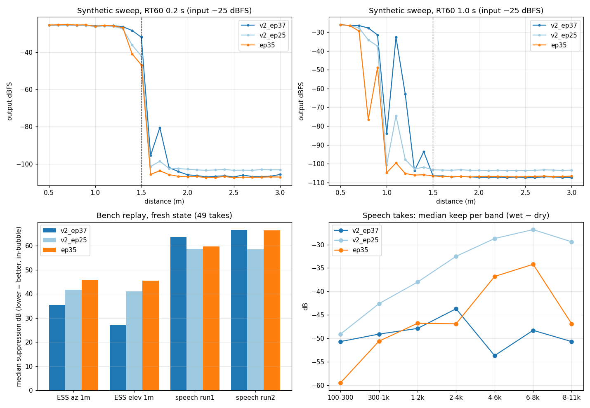

# v2 epoch 37 vs epoch 25 vs EP35: synthetic + bench sweep comparison

**Date:** 2026-11-05
**Candidate:** v2 run `runs/optim_finetune_ep24_ep35prog_synreal_lean_v2_from_ep24/checkpoints/last.pt` = **epoch 37**. Training is still running, and `best.pt` is still epoch 25 because `val/loss` hasn't improved. The checkpoint was copied unchanged (sha256 `9ad6eff4…`) and exported to ONNX: opset 9, `onnx.checker` OK, Torch↔ORT equivalence OK over 5 frames.
**Baselines:** v2 epoch 25 (`runs/_eval_v2_ep25_vs_ep35_20261104/v2_ep25.onnx`), EP35 (`edge/zoo/optim_sonitude_dist_count_1_5m_ep35.onnx`).
**Protocol:** identical to `docs/eval_v2_ep25_vs_ep35_20261104.md`. All 49 bench rows are replayed fresh-state through the C++ runtime, with recorded gains and mic gains, map `5,4,3,2,1,0`, and limiter and gate off. The epoch 25 and EP35 numbers reproduce the earlier run within 0.1 dB.
**Eval folder:** `runs/_eval_v2_ep37_20261105/`

## Results

### Bench (suppression in dB, in-bubble, so lower = better)

| Set | n | ep37 | ep25 | EP35 | ep37 − ep25 (better / worse > 2 dB) | ep37 − EP35 (better / worse) |
|---|---:|---:|---:|---:|---|---|
| ESS azimuth 1 m | 14 | **35.5** | 41.7 | 45.8 | −3.5 (9 / 0) | −5.5 (9 / 0) |
| ESS elevation 1 m | 6 | **27.1** | 41.1 | 45.5 | **−13.9 (6 / 0)** | −17.4 (6 / 0) |
| Speech run 1 | 15 | 63.7 | **58.7** | 59.8 | +1.4 (3 / 6) | −0.4 (3 / 5) |
| Speech run 2 (elev × 0.5/1.0/1.5 m) | 14 | 66.6 | **58.6** | 66.4 | +1.4 (1 / 6) | −2.0 (7 / 2) |
| **All** | 49 | 47.6 | 50.2 | 56.0 | +0.6 (19 / 12) | −2.1 (25 / 7) |

**ESS highlights for ep37:**
- el −60°: 23.5 dB (ep25 63.7, EP35 78.8)
- el +60°: 25.8 dB (45.3 / 59.1)
- az 120°: 36.7 dB (71.1 / 74.1)
- az 180°: 33.8 dB (40.7 / 56.0)

The 30°/60° azimuths are still closed (about 71–74 dB for all three models), so the left/right asymmetry remains (30° 73.9 vs 330° 22.6 dB).

**Speech, median keep per band** (100-300 … 8-11k Hz):

| Model | 100-300 | 300-1k | 1-2k | 2-4k | 4-6k | 6-8k | 8-11k |
|---|---:|---:|---:|---:|---:|---:|---:|
| ep37 | −51 | −49 | −48 | −44 | −54 | −48 | −51 |
| ep25 | −49 | −43 | −38 | −32 | −29 | −27 | −29 |
| EP35 | −60 | −51 | −47 | −47 | −37 | −34 | −47 |

ep37's speech residue is flatter but 10–25 dB lower above 1 kHz than ep25's.

### Synthetic distance sweep (output dBFS, input −25)

| Distance | RT60 0.2: ep37 / ep25 / EP35 | RT60 0.8 | RT60 1.0 |
|---:|---|---|---|
| 0.8 m | −25.6 / −25.6 / −25.4 | **−27.0** / −28.4 / −30.4 | **−27.7** / −34.1 / −76.5 |
| 1.0 m | −25.8 / −26.3 / −26.1 | **−57.6** / −100.3 / −104.6 | −84.0 / −100.6 / −104.8 |
| 1.2 m | −25.8 / −26.2 / −25.9 | **−42.2** / −88.2 / −102.8 | **−62.9** / −97.8 / −105.2 |
| 1.4 m | **−28.3** / −36.2 / −40.9 | −70.0 / −100.7 / −105.5 | −93.6 / −101.8 / −105.9 |
| 1.5 m | **−32.0** / −42.0 / −46.9 | −106.1 / −103.2 / −106.5 | −106.4 / −103.3 / −106.5 |
| 1.7 m | **−80.6** (leak) / −98.5 / −103.7 | −106 / −103 / −107 | −107 / −103 / −107 |
| 2–3 m | −106 / −103 / −107 | −107 / −103.5 / −107 | −107 / −103.5 / −107 |

- **Dry edge:** sharper and closer to 1.5 m than either baseline.
- **Reverberant keep:** improved out to 1.2 m, but still non-monotonic (holes at 1.0 m).
- **Far rejection:** back to EP35 depth, about −107 dBFS.
- **New leak:** a spike to −80.6 dBFS at 1.7 m in the dry room.

## Observations

1. **Synthetic and ESS improved clearly.** Epoch 37 is the best model so far on the synthetic sweep and on the real-array ESS sweeps. The steep elevations and rear azimuths now open (23–37 dB), where EP35 sat at 56–79 dB.
2. **Speech on the real array did not improve.** It is slightly worse than ep25 (median +1.4 dB) and about equal to EP35. The residue loses its high end: 4–11 kHz keep −48…−54 dB vs ep25's −27…−29. Speech is the closer proxy for real use, so **epoch 37 is not a clear upgrade for listening**. The model has improved more on stationary broadband sweeps than on speech.
3. **What hasn't changed:**
   - in-bubble speech is still 60+ dB suppressed, fresh state
   - 1.5 m is still closed (67–70 dB)
   - 30°/60° azimuths are still closed
   - the problems listed in `docs/training_iteration_v3_design_20261104.md` (P1 state lock-in, P2 real distance cues, P3 direction bias) still stand
4. **Checkpoint selection:** `best.pt` stayed at epoch 25 because the suppression-biased `val/loss` (P4) hasn't improved, yet epoch 37 is better on synthetic and ESS. This supports the composite selection metric in §3.5 of the v3 design.
5. **Recommendation:**
   - Keep **EP35 as the default**.
   - Use epoch 37 as a **bench A/B candidate for ESS and polar work**.
   - For listening, compare ep25 and ep37 live by ear, since speech metrics favour ep25.
   - Re-check the last epoch when training ends, using this folder's scripts.

## Files (`runs/_eval_v2_ep37_20261105/`)

| File | Content |
|---|---|
| `v2_ep37_last.pt`, `v2_config.json` | Unmodified checkpoint copy + run config |
| `v2_ep37.onnx`, `.runtime.json` | Eval export (not a zoo artifact) |
| `synthetic_sweep_v2_ep37.csv/.png`, `run_synthetic_sweep.py` | Synthetic sweep (same script/settings as ep25) |
| `bench_replay.json`, `eval_models_on_bench.py`, `bench_replay.log` | Three-model bench replay |
| `v2_ep37_vs_ep25_vs_ep35.png` | Figure above |

**Reproduce:**
- Bench replay: `python -I runs/_eval_v2_ep37_20261105/eval_models_on_bench.py runs/_eval_v2_ep37_20261105`
- Synthetic sweep: `python runs/_eval_v2_ep37_20261105/run_synthetic_sweep.py`. Don't pass `-I`, because onnxruntime is installed in the user site-packages.
