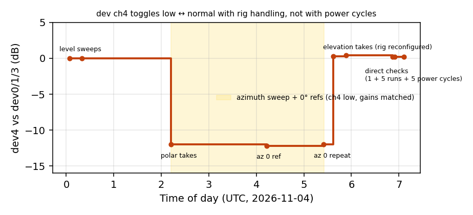
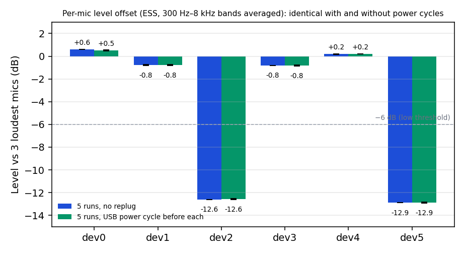
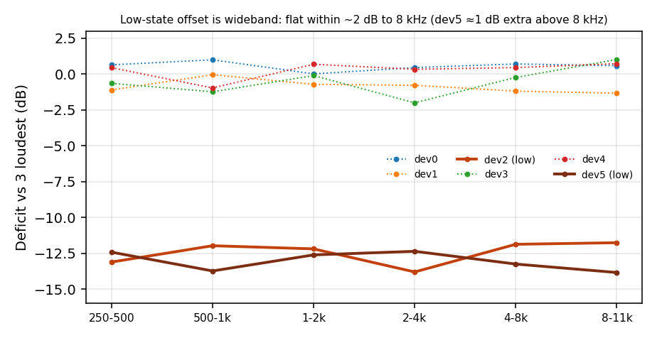
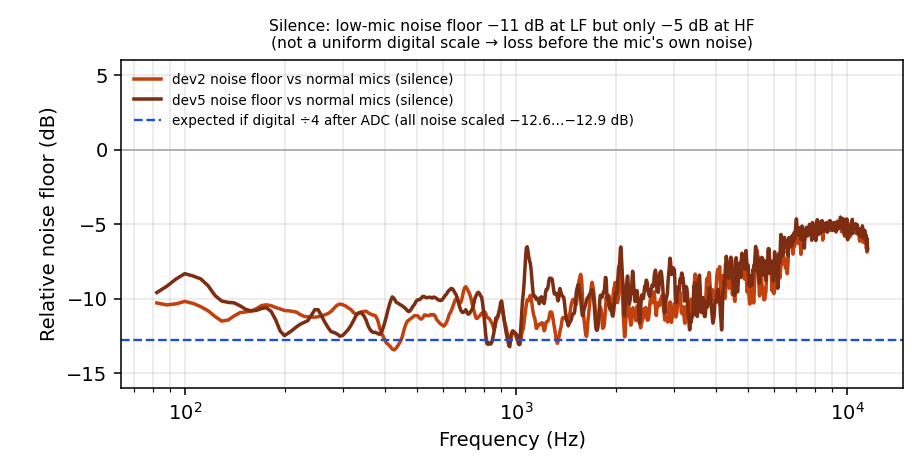

# Pico mic array: "low-state" channels — investigation and level calibration

**Date:** 2026-11-04
**Hardware:** Pico 2 W `INMP441 8ch + DAC 2ch 32b` (6 INMP441 MEMS mics, firmware `pico2w-audio-8in2out`), Windows testbench, stimulus out QUAD-CAPTURE 1-2 (left), HATS rig
**Data:** `measure/mic_state_20261104/` · **Figures:** `docs/img/mic_low_state_20261104/`
**Related:** `docs/polar_sweep_1m_ep35_20261104.md` (polar/elevation sweeps where this was found) · `docs/MIC_FX_CALIBRATION.md` (capsule tests) · `firmware/FIRMWARE_VERSION_TRACKER.md`

## Summary

- **The problem:** on the headset array, some mics read about **12.5–13 dB low** across the whole band.
  - Device channels **2 and 5** are low **permanently**.
  - Device channel **4 toggles** between low and normal.
- **The effect on the model:** EP35 relies on inter-mic level and phase cues. A 13 dB miscalibrated channel made it delete in-bubble sources off-axis (up to about 80 dB suppression at −60° elevation). Correcting only the wideband offset recovered a flat −12…−28 dB keep (see the polar doc).
- **Calibration rule:** correct a mic **only if its offset is wideband** (≥ 6 dB, flat within 3 dB from 250 Hz to 8 kHz). Never flatten frequency-dependent differences, which are acoustic and carry direction.
- **Current suggested levels** (testbench defaults, with model level −19 dBFS and +15 dB input gain):

| dev ch | 0 | 1 | 2 | 3 | 4 | 5 |
|---|---:|---:|---:|---:|---:|---:|
| Correction | 0 | 0 | **+12.6 dB** | 0 | 0 *(+12.1 if low)* | **+12.9 dB** |
| Linear gain | ×1.514 | ×1.514 | **×6.458** | ×1.514 | ×1.514 *(≈ ×6.1 if low)* | **×6.685** |

- **Root cause:** the loss happens in the **acoustic/transducer domain** (mounting/port, or module sensitivity), not in firmware or digital scaling. It's **not** a boot or enumeration state: 5 USB power cycles changed nothing. dev 4's toggles follow rig handling. The decisive next test is a **module swap** (dev 2 ↔ dev 3).

## How the issue was found

During the 2026-11-04 polar and elevation sweeps:

- The raw mic levels showed three channels about 12 dB low.
- At 05:37, dev 4 jumped back to normal while its testbench gain was still calibrated for the low state. In the off-axis elevation takes, one model input was therefore 13 dB hot, and EP35 suppressed those in-bubble sources by 47–80 dB.
- An offline replay with only the wideband offset corrected brought them back to 32–44 dB, with flat keep across the band.

## Timeline of dev ch4

| Time (UTC) | Source | dev 4 vs dev 0/1/3 |
|---|---|---|
| 00:04–00:23 | level sweeps | ≈ 0 dB (normal) |
| 02:12–05:25 | all polar takes incl. the azimuth sweep, 0° refs | ≈ −12 dB (low) |
| 05:37–05:53 | elevation takes (rig reconfigured) | ≈ 0 dB (normal) |
| 06:52–07:09 | direct checks, incl. 5 USB power cycles | +0.2 dB (normal) |

dev 2 and dev 5 were low in every capture all day.

## Method: direct capture (no pipeline)

`measure/mic_state_20261104/scripts/mic_state_check.py`:

1. Stop the testbench pipeline (the Pico input is WDM-KS exclusive).
2. Play the bench ESS (`256kMeasSweep_0_to_20000_-20_dBFS_44k_Float_LR_refL.wav`, left leg) on the stimulus device with the testbench's own `StimulusPlayer`.
3. Record the 8-channel Pico input directly as raw int32 at 24 kHz.
4. Over the active sweep, measure each mic's level in 5 bands (250–500, 500–1k, 1–2k, 2–4k, 4–8k Hz), plus 8–11 kHz, relative to the mean of the **3 loudest mics**.
5. **Wideband test:** low if the mean deficit is ≥ 6 dB **and** the flatness (max − min across bands) is ≤ 3 dB.
6. Also record SNR, noise floor (quietest frames) and int32 trailing-zero bits.

The speaker stayed at the last take pose (az 0°, el +30°, 1 m). Near the front, the natural differences between mics are ≤ 2.4 dB, far below the 12 dB being detected.

**Limit:** at lateral azimuths (60–150°, 240–300°), head shadow makes the per-pose test unreliable. Judge the hardware state from a front-facing reference or a calibration take.

## Results

### 5 repeat runs (06:55 UTC) and 5 USB power cycles (07:06–07:09 UTC)

For the power-cycle series, the operator physically unplugged and replugged the Pico before each sweep, and `mic_replug_series.py` detected each disconnect and reconnect and ran the sweep.

| dev ch | Raw level (dBFS) | Deficit, no replug | Deficit, after replug | Flatness | 8–11 kHz | Noise floor (dBFS) | State |
|---:|---:|---:|---:|---:|---:|---:|---|
| 0 | −21.94 | +0.60 ± 0.00 | +0.52 ± 0.04 | 0.9 | +0.6 | −63.2 | normal |
| 1 | −23.41 | −0.78 ± 0.04 | −0.78 ± 0.04 | 1.2 | −1.3 | −64.2 | normal |
| 2 | −35.09 | **−12.60 ± 0.00** | **−12.56 ± 0.05** | 2.0 | −11.8 | −73.5 | **low** |
| 3 | −22.82 | −0.80 ± 0.00 | −0.82 ± 0.04 | 2.0 | +1.0 | −63.5 | normal |
| 4 | −21.95 | +0.18 ± 0.04 | +0.20 ± 0.00 | 1.6 | +0.8 | −62.8 | normal |
| 5 | −35.30 | **−12.90 ± 0.00** | **−12.88 ± 0.04** | 1.3 | −13.9 | −73.9 | **low** |

- **Repeatability:** within 0.05 dB per mic. A USB power cycle doesn't change the low set ([2, 5] every time) or the offsets (Δ ≤ 0.08 dB).
- **Device numbering:** after a replug the indices change (Pico in 37 → 31, stimulus out 41 → 35). **The testbench must re-select devices after any replug.**

### Silence capture (10 s, no stimulus)

- **Low channels' noise floor vs normal:** −11 dB at 100–1000 Hz, −10 dB at 1–4 kHz, −8 dB at 4–8 kHz, **−5 dB at 8–11 kHz**.
- **A digital scale after the ADC** would lower *all* noise by the full 12.6–12.9 dB at every frequency (the dashed line).

## Root-cause analysis

| Evidence | Conclusion |
|---|---|
| Capture straight from the USB device | Not the runtime, testbench or mic gains |
| Deployed `pico2w-audio-8in2out`: `k_mic_cal_gain = {1,1,1,1,1,1}`, shared ×2 makeup | Not firmware per-channel gain |
| Offsets 12.6 / 12.9 dB (not 12.04) and flat within ≤ 2 dB to 8 kHz | Gain-like loss, not an exact ÷4 bit shift |
| **Noise floor in silence only −5 dB at HF** (self-noise dominated) but −11 dB at LF (room-noise dominated) | The loss attenuates the acoustic signal **before** the transducer's own electrical noise: **acoustic/transducer domain** |
| Clean waveforms (DC ≈ 0, skew ≈ 0); coherence with neighbours 0.65–0.75 (normal pairs 0.68–0.73) | No bit corruption or sign loss |
| int32 trailing-zero bits identical on all channels | Inconclusive (firmware FX and makeup gain rewrite the LSBs) |
| 5 USB power cycles: identical state and offsets | **Not a boot or enumeration state** (I2S/PIO alignment, MEMS start-up mode, USB alt setting) |
| dev 4 toggles with rig handling, never with power | Mechanical or contact intermittency for dev 4 |
| Capsule tests on seat 0: installed modules within ~2 dB (`MIC_FX_CALIBRATION.md`) | Modules fine individually, which points at the seat or mount |
| Old 6-ch firmware cal table (commented out) compensated a different ~14 dB-low trio | Long-standing, and the affected set changes over time |

**Ranked hypotheses:**
1. **Seat mount or port** (gasket, foam or housing over the INMP441 bottom port; misaligned port hole) for dev 2 and 5, plus **mechanical/contact intermittency for dev 4**. Fits everything; a near-flat loss to 11 kHz is a little atypical for a partial seal.
2. **Low-sensitivity or damaged MEMS modules** at the dev 2 and 5 seats (like the binned M1, about 14 dB low).
3. **Supply or ground at those seats.** Unlikely now (unaffected by power cycling), unless it's a mechanical contact.
4. *Strongly disfavoured:* firmware/I2S capture alignment or packing.

**Decisive next tests (hardware, owner):**
- (a) **Module swap:** dev 2 ↔ dev 3, then re-run the check. If the low state follows the module, it's the module; if it stays with the seat, it's the mount, port or wiring.
- (b) Inspect the port, gasket and foam at the dev 2, 5 and 4 seats.
- (c) Press or flex dev 4 while running the check repeatedly.
- (d) Measure VDD and GND at each module under operation.

Firmware was not modified (owner-gated, `.cursor/rules/firmware-version-tracker.mdc`).

## Operating procedure (until fixed)

1. **Before each measurement session, and after any replug or rig handling:** stop the pipeline and run `python measure/mic_state_20261104/scripts/mic_state_check.py` (or `debug/mic_state_check.py`). It takes about 15 s and plays the ESS.
2. **If dev 2 and 5 are low (expected) and dev 4 is normal:** keep the testbench defaults (table above).
3. **If dev 4 reads low:** set its fader to about ×6.1.
4. **If anything else changes:** apply the wideband rule to the new offsets, or ask for a re-calibration.
5. **After a replug:** re-select the devices in the testbench Setup tab (the indices change).

Testbench defaults live in `tools/tech_testbench/app/session.py`: `MIC_REF_LEVEL_DBFS = -22.6`, `MIC_WIDEBAND_OFFSET_DB = (0, 0, -12.6, 0, 0, -12.9)`.

## Data index (`measure/mic_state_20261104/`)

| Path | Content |
|---|---|
| `single/mic_state_check_20261104_065214.{json,wav}` | First direct check (06:52) |
| `no_replug/mic_state_check_20261104_0655*/0656*.{json,wav}` | 5 repeat runs |
| `replug/mic_state_check_20261104_0706*…0709*.{json,wav}` | 5 runs, each after a USB power cycle |
| `mic_state_check_20261104_silence10s.wav` | 10 s silence capture |
| `stimulus/256kMeasSweep_0_to_20000_-20_dBFS_44k_Float_LR_refL.wav` | The ESS played in every check (2 ch, 44.1 kHz, 13.37 s; left leg used). sha256 `9bd5a1cc6c6ec99b…`, same as the polar takes |
| `mic_state_check_series_20261104.json` | 5-run summary |
| `mic_replug_series_summary_20261104.json` | Replug vs no-replug comparison |
| `mic_replug_series_20261104_070246.log` | Replug session log |
| `scripts/` | `mic_state_check.py`, `mic_replug_series.py`, `mic_state_figures.py` |
| `figures/` | Figures 01–04 (also in `docs/img/mic_low_state_20261104/`) |

**WAV format:** every capture (`single/`, `no_replug/`, `replug/`, silence) is the raw Pico input: **8 ch, 24 kHz, float32**, about 14.5 s (10 s for silence). Channels 0–5 are the six mics in **device order** (before any channel map, with no mic gains applied); channels 6–7 are unused (silent). The sweep starts about 0.5 s in.

Each run's JSON holds, per mic: raw level, SNR, noise floor, 5-band deficit, flatness, mean deficit, 8–11 kHz deficit, trailing-zero bits and the state decision.
