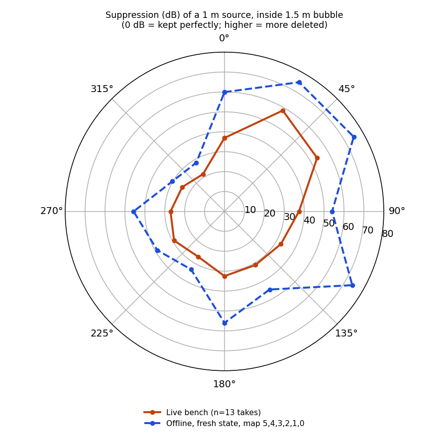
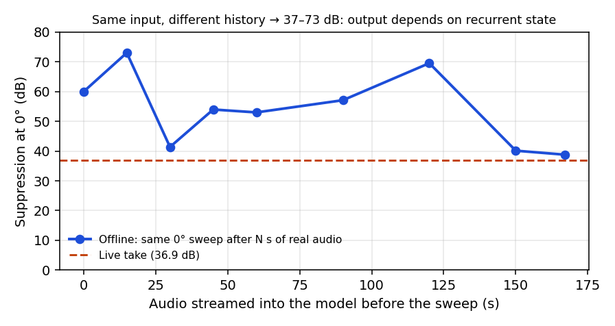
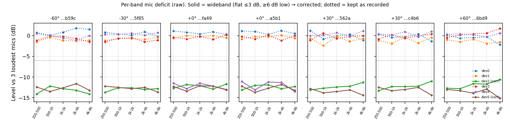
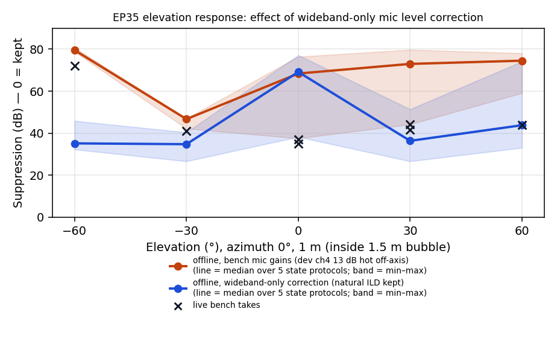
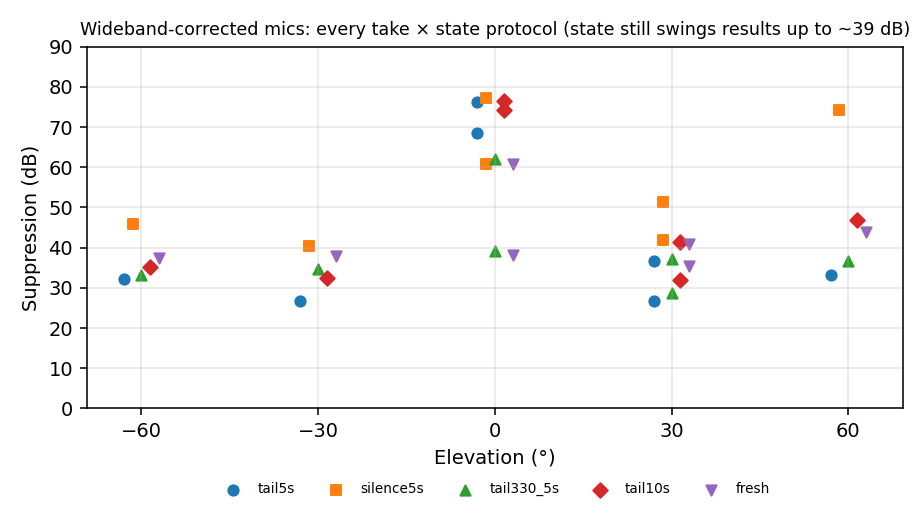
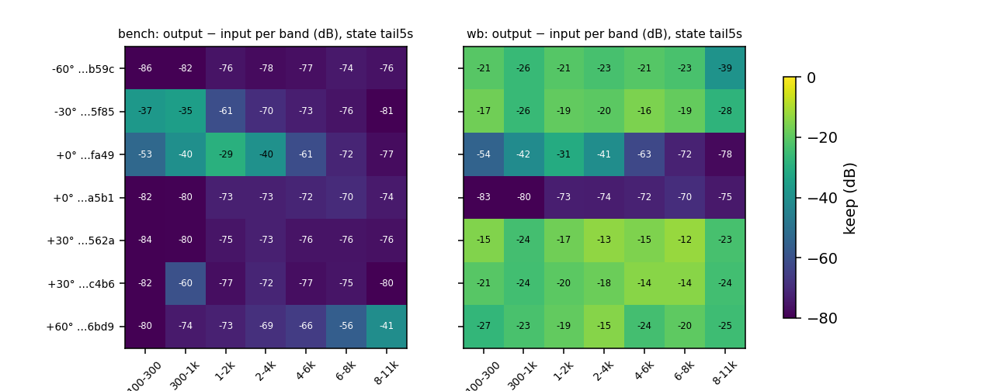
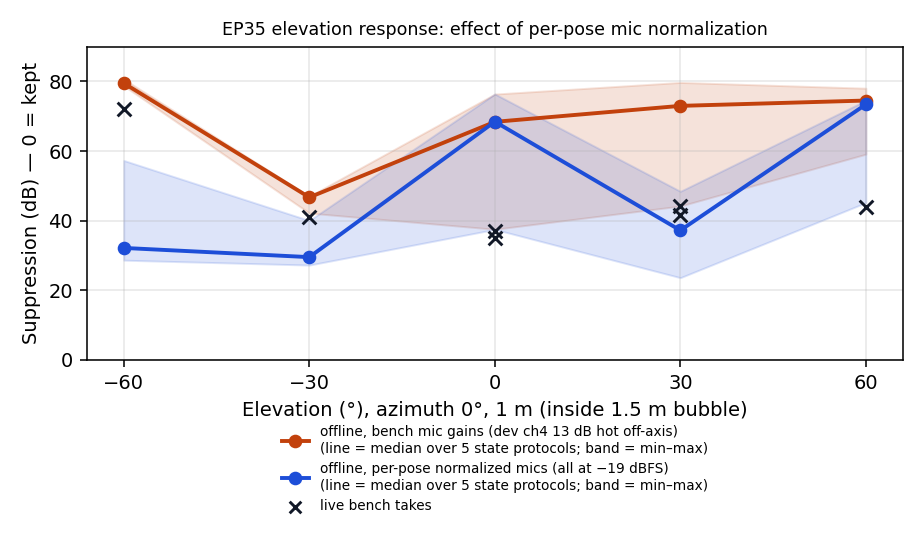
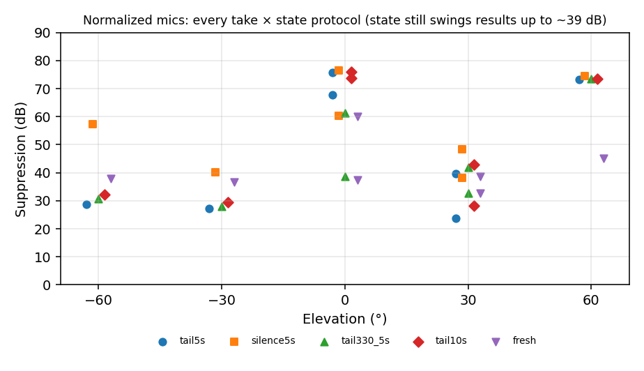
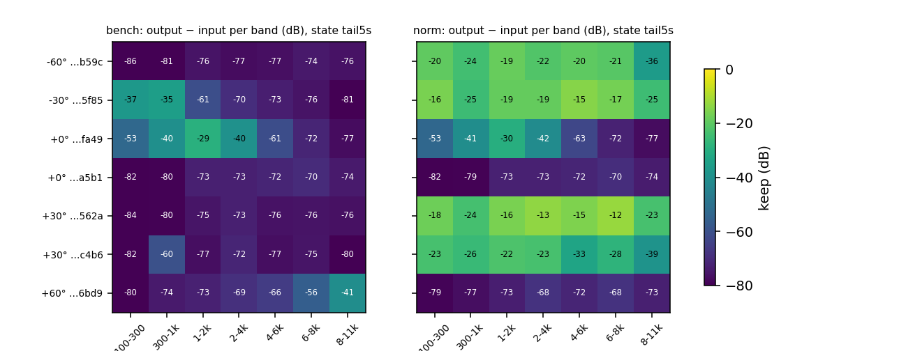

# Polar azimuth + elevation sweeps @ 1 m (EP35) and the recurrent-state observation

> **Recorded data (raw WAVs + per-take results):** Google Drive, mirroring `measure/`: https://drive.google.com/drive/folders/1gF2gqEybPuUn5eR00L4myzW5VXbS391c?usp=sharing. Index and sha256 manifest: [docs/data/MEASURE_DATA_20261104.md](data/MEASURE_DATA_20261104.md).

**Date:** 2026-11-04
**Status:** **VALID / PROTECTED.** Raw sweeps, trial data and analysis must not be deleted, moved or overwritten. See [Protected data](#protected-data).
**Run:** `measure/run_20261104_040645_1abaf4`
**Model:** `edge/zoo/optim_sonitude_dist_count_1_5m_ep35.onnx` (bubble 1.5 m)
**Runtime:** `soundbubble-rt` (C++), Windows testbench, live global pipeline

## TL;DR

1. A full horizontal sweep (0–330° in 30° steps, 13 takes) of a source at **1 m (inside the 1.5 m bubble)** passed technical QA and is marked valid.
2. The live polar response is **strongly lopsided**. Mirror angles differ by up to 37 dB (30° = 58.5 dB suppressed vs 330° = 21.6 dB). The array itself is symmetric: mic delays and levels mirror exactly between ±90°.
3. **Main observation: EP35's output depends heavily on what it heard before.** The same recorded 0° sweep replayed offline gives **37–73 dB** of suppression, depending only on how much audio was streamed through the model beforehand. Two live 90° takes that are acoustically identical (levels within 0.1 dB, identical delays) differ by **14 dB**.
4. Consequence: a single take, live or offline, measures **direction plus recent history**. Per-angle numbers are only good to roughly ±7 dB, and comparisons between maps or models need a fixed state protocol.
5. The live "buzz" floor is part of the same effect. In the wet output after the sweep's onset, offline from a fresh state the residue decays to about −85 dBFS; after 167 s of history it sits at −63 dBFS; live it sits at −48 dBFS. The 125 Hz hop-rate comb rides on that floor.
6. **Elevation sweep** (−60…+60°, az 0): the −60/−30 labels were swapped at capture. They're relabelled, and the mic delays confirm the correction. The five off-axis takes are status **check** (valid, but need manual evaluation), because **device ch4 jumped back up about 13 dB** between 05:25 and 05:37 while its mic gain stayed at the low-state calibration. One model input was therefore about 13 dB hot in those takes.
7. **Device ch4 is intermittent:** normal → low → normal over the day, in about 12 dB steps (≈ a 2-bit / ×4 shift). That's an I2S or firmware-side suspect (owner territory).
8. **Repeatability at 0°/0°:** 36.9 dB (04:13) vs 35.0 dB (05:25) with balanced mics. The 90° pair, by contrast, differed by 14 dB.
9. **Aggregator bug fixed:** polar cuts did not hold the other angle, so az-0 elevation takes were pooled into the azimuth 0° point (45.0 dB, n=7 instead of 36.0 dB, n=2). Azimuth polars now use el = 0 only, and elevation polars az = 0 only.
10. **Offline wideband-only mic correction** (5 state protocols): the low-state offset is wideband (11.9–13.6 dB, flat within 2.4 dB over 250 Hz–8 kHz). Correcting only that, while keeping natural inter-mic differences, improves −60, −30, +30 and +60 by 12–46 dB and gives a flat −12…−28 dB keep across 100 Hz–8 kHz at every off-axis pose. 0° is unchanged (state effect). Earlier per-pose normalization is superseded; it erased natural ILD and failed at +60°. See [the wideband section](#offline-elevation-evaluation-with-wideband-only-mic-level-correction).
11. **Azimuth sweep is not affected by the hot-channel issue.** dev ch4 was in its low state throughout (04:13–04:49) and the bench gains matched it (±0.6 dB vs the wideband rule). Per-pose wideband detection is unreliable at lateral azimuths (head shadow), so judge hardware state from a front-facing reference. Testbench defaults are switched to the wideband rule (dev4 assumed normal; it toggles).
12. **Direct 5-run mic check:** dev 2 −12.6 and dev 5 −12.9 dB (sd ≤ 0.04 dB), dev 4 normal. The noise-floor signature (−11 dB at LF but only −5 dB at 8–11 kHz) places the loss in the acoustic/transducer domain, not firmware or digital scaling (deployed firmware cal is unity). The prime suspect is the seat mount or port, then module sensitivity; a module-swap test is decisive.
13. **5 USB power cycles (physical replug):** same low set [2, 5] and the same offsets within 0.08 dB every time; dev 4 stayed normal. So it's not a boot or enumeration state (disfavours firmware/I2S alignment further). dev 4's toggles line up with rig handling, which suggests a mechanical/contact cause. Device indices change on replug (37→31, 41→35), so re-select devices in the testbench after replugging.
14. **Speech takes (15, talker 1 m inside the bubble):** EP35 is bimodal, either closed (74–78 dB) or open then closing (starts −14…−34 dB, loses 16–29 dB within a take), and switches between takes at an identical input. When open, the highs pass and the lows are cut (bright residue). The +30/+60° speech takes all fell in a closed period. Write-up: [docs/speech_algorithm_tests_ep35_20261104.md](speech_algorithm_tests_ep35_20261104.md).
15. **Speech × elevation × distance run** (11 takes, 1 m and 0.5 m, −60…+60°): live, EP35 was closed at every pose (69–77 dB, even 0.5 m straight ahead) despite a pipeline restart 26 s before. Offline fresh-state replay of the same audio opens at 0°/above (32–54 dB) and stays closed below (−60° 78 dB). Quiet periods lock the model closed. Write-up: [docs/speech_elevation_tests_ep35_20261104.md](speech_elevation_tests_ep35_20261104.md).

## Setup (all 13 takes identical)

| Item | Value |
|---|---|
| Stimulus | ESS `256kMeasSweep_0_to_20000_-20_dBFS_44k_Float_LR_refL.wav`, left leg, 13.37 s |
| Geometry | distance 1.0 m, elevation 0°, azimuth 0…330° step 30° (90° taken twice) |
| Channel map | `5,4,3,2,1,0` (from `edge/MIC_INDEX_CANON.md` §4) |
| Mic gains (linear, dev ch0..5) | 1.429, 1.603, 6.607, 1.549, 6.237, 6.607 (normalized to −19 dBFS; see `tools/tech_testbench/app/session.py`) |
| Input / output gain | +15 dB / 0 dB, limiter on, mix_dry 0 |
| Model input level | dry ≈ −5 dBFS (bench-best setting chosen by listening) |

## QA (pass criteria)

Every take met all of the following (script: `debug/check_polar_sweep.py`):

- Same model, contract, channel map, gains, mic gains, stimulus, distance and elevation as the 0° reference.
- `runtime_exit_code == 0`, taps not missing or truncated, no `*.part*.wav`, and tap WAVs not rewritten after the take. This guards against the tap-overwrite bug fixed on 2026-11-04.
- 0 underruns during the take.
- Raw mic SNR ≥ 43 dB (300–4000 Hz).
- Model input level within 6 dB of the reference.

Two judgement calls, recorded in each trial's `trial.json` → `validity.note`:

- **30° and 60°:** HATS SNR is low (1 and 9 dB) because the model suppressed those angles by 54–59 dB. That's the result, not a capture fault.
- **90° (two takes):** acoustically identical but 14 dB apart in output. Both are kept and averaged (n = 2).

## Results: live polar

Suppression = dry − wet band level, 300–3400 Hz (testbench analyzer). 0 dB would mean the in-bubble source is kept perfectly.

| Azimuth | Trial | Live suppression (dB) | HATS product band (dB) | Offline, fresh state (dB) |
|---:|---|---:|---:|---:|
| 0° | `polar_20261104_041315_fa49` | 36.9 | −16.8 | 59.9 |
| 30° | `polar_20261104_042344_e019` | 58.5 | −33.0 | 74.9 |
| 60° | `polar_20261104_042717_9fa3` | 53.7 | −30.6 | 74.9 |
| 90° | `polar_20261104_043206_8964` | 30.3 | −9.2 | 54.0 |
| 90° | `polar_20261104_043300_b256` | 44.5 | −23.1 | 54.0 |
| 120° | `polar_20261104_043606_c88f` | 32.7 | −12.8 | 74.1 |
| 150° | `polar_20261104_043759_f75e` | 31.1 | −11.0 | 45.3 |
| 180° | `polar_20261104_044024_63dc` | 32.5 | −12.5 | 56.0 |
| 210° | `polar_20261104_044207_867c` | 26.3 | −6.8 | 33.6 |
| 240° | `polar_20261104_044324_1871` | 29.2 | −10.7 | 39.0 |
| 270° | `polar_20261104_044523_c18c` | 27.1 | −7.5 | 45.7 |
| 300° | `polar_20261104_044728_e8fb` | 24.5 | −3.6 | 30.2 |
| 330° | `polar_20261104_044933_7fb5` | 21.6 | −1.3 | 28.3 |



**Lopsidedness:**

- Mirror pairs: 30°/330° differ by 36.9 dB, and 60°/300° by 29.2 dB.
- The array is symmetric. GCC-PHAT delays mirror exactly (+0.917 ms at 90°, −0.917 ms at 270°) and mic levels mirror.
- So the asymmetry comes from the model's response to this array, not from the array or the room.
- Offline (fresh state) shows the same shape: the 0–120° side is heavily suppressed, and 300–330° is kept best.

## Main observation: output depends on recurrent state

### Live ≠ offline replay

`soundbubble-rt --input-wav` on each take's `raw_8ch.wav` with identical settings:

- **Inputs match:** dry_ref is identical to the live tap (correlation 1.000, lag 0).
- **Outputs differ:** wet is only partly similar (correlation 0.63), and offline suppression is 6–41 dB higher at every angle.
- **Not explained by config:** `--hops-per-io` 1 vs 2 changes nothing.

(Earlier on 2026-11-04 the C++ offline path was shown to be identical to the Python runtime, correlation 1.000. The difference here is live vs offline, not C++ vs Python.)

### Same input, different history

The 0° sweep was replayed after N seconds of other real takes from this run were streamed through the model first (script: `history_curve.py`):

| History before sweep (s) | 0 | 15 | 30 | 45 | 60 | 90 | 120 | 150 | 167 | live |
|---|---:|---:|---:|---:|---:|---:|---:|---:|---:|---:|
| Suppression at 0° (dB) | 59.9 | 73.0 | 41.4 | 54.0 | 53.0 | 57.1 | 69.5 | 40.1 | 38.8 | 36.9 |



- Identical input, 37–73 dB spread. The dependence is **erratic, not a monotonic drift**.
- Synthetic histories behave the same way: 30 s of silence gives 68.3 dB, 60 s of looped room noise gives 72.5 dB, and the previous take gives 64.2 dB.

### Residual floor ("buzz") grows with streaming history

Median wet level 2–12 s into the 0° take:

| Condition | Wet floor | 125 Hz comb share at −80…−65 dBFS |
|---|---:|---:|
| Offline, fresh state | −84.7 dBFS | 12% (42% below −80) |
| Offline, 167 s history | −62.7 dBFS | 32% |
| Live (session running for many minutes) | −47.9 dBFS | 37% (68% below −80) |

- The hop-rate comb (125 Hz harmonics, from the 192-sample hop at 24 kHz) is present in every case, so it's inherent to the model's output.
- How loud it gets tracks the state history.
- Output gain makes it audible.

### Interpretation (working hypothesis)

- EP35 is a causal TF-GridNet with recurrent state, trained on short (about 5 s) clips.
- Live, it streams for minutes to hours, which is far outside the state trajectories it ever saw in training.
- Its behaviour then depends on accumulated state: suppression strength, the residual floor and even the apparent directivity.
- This fits all three symptoms: the live/offline gap, the 14 dB repeat variance, and the noisy, lopsided polar.

Not yet ruled out: the channel order may additionally be wrong. The offline channel-order screen (all 720 orderings, fresh state, scored on 0°/30°/330°) is running. Its results go in [Pending](#pending-channel-order-screen).

## Elevation sweep (az 0°, 1 m)

Same setup and gains as the azimuth sweep. Taken 05:25–05:53.

| Elevation | Trial | Time (UTC) | Status | Suppression (dB) | HATS band (dB) | Top-mic delay (ms) | Raw dev ch4 (dBFS) | Model-input mic spread (dB) |
|---:|---|---|---|---:|---:|---:|---:|---:|
| 0° | `polar_20261104_041315_fa49` | 04:13 | pass | 36.9 | −16.8 | 0.000 | −35.9 | 0.1 |
| 0° | `polar_20261104_052501_a5b1` | 05:25 | pass | 35.0 | −15.7 | 0.000 | −35.9 | 0.3 |
| −60° | `polar_20261104_053736_b59c` | 05:37 | **check** | 72.0 | −19.2 | +0.333 | **−23.7** | **13.1** |
| −30° | `polar_20261104_054213_5f85` | 05:42 | **check** | 41.2 | −18.3 | +0.125 | **−23.1** | **13.4** |
| +30° | `polar_20261104_054708_562a` | 05:47 | **check** | 44.3 | −13.4 | −0.208 | **−22.2** | **13.5** |
| +30° | `polar_20261104_055249_c4b6` | 05:53 | **check** | 41.6 | −12.4 | −0.208 | **−22.4** | **13.5** |
| +60° | `polar_20261104_055042_6bd9` | 05:51 | **check** | 44.0 | −14.3 | −0.354 | **−22.2** | **14.0** |

Aggregate (elevation cut at az = 0): −60° 72.0 · −30° 41.2 · 0° 36.0 (n=2) · +30° 43.0 (n=2) · +60° 44.0 dB.

### −60° / −30° relabel

- **The swap:** the operator reported the two labels were swapped at capture. `053736_b59c` is now **−60°** (it was labelled −30°), and `054213_5f85` is now **−30°** (it was labelled −60°).
- **Physical confirmation:** the mics sit on a vertical arc with mapped mics 2 and 3 at the top. A source below the array reaches the top mics later, and the delay grows with depth: +0.125 ms at −30° and +0.333 ms at −60°. This mirrors the takes above (−0.208 ms at +30°, −0.354 ms at +60°). The corrected labels now step monotonically.
- **Edited in:** `trial.json` `elevation_deg` (with a `relabel` block holding from/to, time and evidence), `metrics.json` `elevation_deg`, and both `telemetry.jsonl` rows (`relabeled_from_elevation_deg`).
- **Originals:** backed up in `analysis/relabel_backup_20261104/`.

### Why "check" and not "pass"

All five off-axis takes pass the technical QA: exit 0, 0 underruns, intact taps, mic SNR ≥ 47 dB, dry level within 6 dB.

**However, device ch4 returned to its normal level** (raw about −22.5 dBFS, was about −36 dBFS) between 05:25 and 05:37. Its mic gain stayed at **×6.237**, which was calibrated for the low state. So mapped mic 1, which is fed from device 4, reached the model about **13 dB hot**, giving a 13–14 dB spread across the six inputs, against ≤ 4 dB (natural directivity) in the azimuth set.

These takes are kept as valid data but need manual evaluation before being compared with the azimuth sweep. The −60° low HATS SNR (3 dB) is the 72 dB suppression, not a capture fault.

To finalize the elevation polar: set the dev ch4 fader to about **×1.29** while ch4 is in its normal state (the same −19 dBFS normalization as the other mics), then re-take −60, −30, +30 and +60.

## Offline elevation evaluation with wideband-only mic level correction

**Question:** were the off-axis elevation results driven by the 13 dB hot dev ch4, and what does EP35 do once hardware level offsets are removed but the **natural inter-mic level differences are preserved**?

This supersedes the per-pose normalization below. That method forced every mic to the same level in each pose, which also erased natural, acoustically meaningful level differences.

### Method

1. **Decide which mics to correct (wideband test).**
   - For each take (raw `raw_8ch.wav`, active sweep span), measure each mic's level in five bands (250–500, 500–1k, 1–2k, 2–4k, 4–8k Hz) relative to the mean of the **3 loudest mics** in that take.
   - A mic is corrected **only if its deficit is wideband**: flat within **3 dB** across the bands **and** at least **6 dB** low on average. The correction is a flat gain equal to its measured mean deficit.
   - Frequency-dependent differences (acoustics, head shadow, direction) are left exactly as recorded.
   - Script `deficit_spectra.py`, output `deficit_spectra.json`.
2. **Gains.** One common base gain for all mics, chosen so the corrected mics average −19 dBFS. Corrected mics get base + their deficit. Then the bench's +15 dB input gain.
3. **Replay.** Each take is replayed offline with `soundbubble-rt --input-wav` (EP35, map `5,4,3,2,1,0`, limiter and wet gate off), using the same five **model-state protocols** as before:
   - reset model (12 ORT warm-up runs, state zeroed), then one of: `tail5s`, `silence5s`, `tail330_5s`, `tail10s`, or `fresh` (no pre-roll)
   - only the sweep is scored (testbench analyzer, 300–3400 Hz)
4. **Control.** The bench mic gains (ch4 hot off-axis). That's 7 takes × 2 gain sets × 5 protocols = 70 runs.

### Which mics were corrected

| Take | Elevation | Corrected (wideband low) | Measured deficit (dB) | Flatness over 250 Hz–8 kHz | Model-input spread after correction |
|---|---:|---|---|---|---:|
| `fa49` | 0° | dev 2, 4, 5 | 12.3 / 12.2 / 12.6 | 1.3–1.5 dB | 1.0 dB |
| `a5b1` | 0° | dev 2, 4, 5 | 12.4 / 12.0 / 12.7 | 1.2–2.3 dB | 1.1 dB |
| `b59c` | −60° | dev 2, 5 | 13.3 / 12.7 | 1.9 dB | 2.0 dB |
| `5f85` | −30° | dev 2, 5 | 12.9 / 12.7 | 1.1–1.4 dB | 1.5 dB |
| `562a` | +30° | dev 2, 5 | 12.3 / 13.5 | 1.6–1.8 dB | 1.6 dB |
| `c4b6` | +30° | dev 2, 5 | 12.2 / 13.2 | 2.0–2.4 dB | 1.7 dB |
| `6bd9` | +60° | dev 2, 5 | 11.9 / 13.6 | 2.2 dB | 1.6 dB |

- **Other mics:** they differ by at most about 2.4 dB, with frequency-dependent ripple, and are kept as recorded.
- **dev ch4:** wideband-low only in the two 0° takes (its low state), and normal in all off-axis takes. The test picks this up automatically from the data.
- **Above 8 kHz:** a separate analysis found the low state also drops a further 2–4 dB at 6–10 kHz. Within the 250 Hz–8 kHz test range the shift is flat; above 8 kHz the flat correction is approximate.



### Results

Suppression in dB, as the median over the 5 state protocols, with the min–max in brackets:

| Elevation | Take | Bench gains | **Wideband-corrected** | Live |
|---:|---|---:|---:|---:|
| −60° | `b59c` | 79.5 (79–81) | **35.2** (32–46) | 72.0 |
| −30° | `5f85` | 46.7 (42–47) | **34.8** (27–40) | 41.2 |
| 0° | `fa49` | 61.1 (60–74) | 62.1 (61–74) | 36.9 |
| 0° | `a5b1` | 75.7 (38–76) | 76.2 (38–77) | 35.0 |
| +30° | `562a` | 77.5 (47–80) | **31.9** (27–42) | 44.3 |
| +30° | `c4b6` | 68.5 (44–78) | **40.8** (37–51) | 41.6 |
| +60° | `6bd9` | 74.5 (59–78) | **43.8** (33–74) | 44.0 |





### Observations

1. **The low-state offset is wideband.** Every low-state mic (dev 2 and 5 always, dev 4 at 0°) is 11.9–13.6 dB down, flat within 1.1–2.4 dB from 250 Hz to 8 kHz. That's a gain-type offset, so correcting it doesn't touch acoustic information.
2. **Removing only that offset fixes the whole off-axis elevation response.** −60°, −30°, +30° and +60° improve by 12–46 dB in median (to 32–44 dB), under every state protocol.
3. **The off-axis keep is flat across the band.** At all four off-axis poses, keep is about **−12 to −28 dB from 100 Hz to 8 kHz** (`tail5s`), against −56 to −86 dB with the hot channel. This is the best and most even in-bubble keep measured today.
4. **Preserving natural ILD matters at +60°.** Per-pose normalization (which erased ILD) left +60° at 73.4 dB. Wideband-only correction brings it to 43.8 dB. So the model does use the natural inter-mic level differences.
5. **0° is unchanged.** Bench gains were already calibrated for that hardware state. 0° stays heavily suppressed offline (62/76 dB median, against 35–37 live), which is the recurrent-state effect.
6. **State remains the dominant uncertainty.** A single take still spans up to 39 dB across protocols (0° `a5b1`, 38–77 dB), and `silence5s` is consistently the most suppressive pre-roll for off-axis poses. The bench → corrected drop is the robust result; absolute values are protocol-dependent.
7. **Practical rule for the bench:** before each session, check the per-mic levels. Correct only wideband offsets (≥ 6 dB, flat within 3 dB), and never flatten frequency-dependent differences.

### Does the hot-channel issue affect the azimuth sweep? No

The wideband deficit test was run on every take in the run (`analysis/offline_elev_wideband_20261104/deficit_spectra_all.json`).

- **Hardware state during the azimuth sweep (04:13–04:49) was constant:** dev 2, 4 and 5 were all in the low state. Both front-facing takes that bracket the sweep (04:13 `fa49`, 05:25 `a5b1`) show dev 2, 4 and 5 wideband-low at 12.0–12.7 dB, and dev ch4 only returned to normal after 05:25.
- **The bench mic gains matched that state:** they were calibrated in the same state (`034603_4326`), and at 0° they agree with the wideband rule within **±0.6 dB** per mic.
- So the azimuth model inputs were balanced apart from natural directivity (live spread 0.1–4.0 dB). There was no hot channel, the azimuth polar stands as measured, and an offline wideband re-run would change gains by ≤ 0.6 dB.

**Method limit:** per-pose detection is unreliable at lateral angles.

- At 60–150° and 240–300°, the per-pose test flags only dev 2. dev 4 and 5 look "not low", because the 3-loudest-mic reference shifts with direction, and head shadow (large and frequency-dependent) mixes into the deficit.
- So the hardware state must be judged from a **front-facing reference (az 0, el 0) or a dedicated calibration take**, not per pose.
- The elevation takes are all at az 0, where natural differences are ≤ 2.4 dB, so the per-pose test was valid there.

### Testbench defaults switched to the wideband rule

As of 2026-11-04, in `tools/tech_testbench/app/session.py`:

- **Constants:** `MIC_REF_LEVEL_DBFS = -22.6` (normal-state mic, front take `fa49`) and `MIC_WIDEBAND_OFFSET_DB = (0, 0, -12.4, 0, 0, -12.7)`. `MIC_CAL_LEVELS_DBFS` is derived from them.
- **Default gains** at model level −19 dBFS: **×1.514** for dev 0/1/3/4 (+3.6 dB), **×6.458** for dev 2 (+16.2 dB), **×6.685** for dev 5 (+16.5 dB), updated from the 5-run direct check (first version used single-take offsets −12.4/−12.7: ×6.31/×6.531). Input gain stays at +15 dB.
- **Stability:** dev 2 (11.9–13.3 dB all day) and dev 5 (12.6–12.7 dB at 0°) are stable. **dev 4 toggles.** The defaults assume its current normal state (since 05:37). If it drops back to low (raw ch4 about 12 dB under ch0/1/3), set its fader to about **×6.1** (+12.1 dB on top of ×1.514).
- **Superseded:** the old per-pose defaults (×1.429, 1.603, 6.607, 1.549, 6.237, 6.607) were wrong for dev 4 in its normal state (+12.6 dB too hot).
- **Live hardware check, 2026-11-04 06:52 UTC** (pipeline stopped; ESS on device 41 left channel; 6 Pico mics recorded directly from device 37):
  - dev 2 −12.6 dB and dev 5 −12.9 dB, both wideband (flat within 2.0 / 1.2 dB over 250 Hz–8 kHz).
  - dev 4 **normal** (+0.2 dB). All other mics within 0.8 dB.
  - SNR 39–41 dB on every mic.
  - The defaults match the current hardware state.
  - Data: `debug/mic_state_check_20261104_065214.wav/.json`.
- **Pre-session check:** `python debug/mic_state_check.py` (stop the pipeline first; device 37 is exclusive under WDM-KS). It reports each mic's state and whether dev 4 needs its low-state fader (about ×6.1).

### Data (protected, new files only)

`measure/run_20261104_040645_1abaf4/analysis/offline_elev_wideband_20261104/` contains:

| File | Content |
|---|---|
| `deficit_spectra.json` / `deficit_spectra.py` | Per take × mic: 5-band deficit vs top-3 mics, flatness, mean, wideband decision, correction |
| `deficit_spectra_all.json` / `deficit_spectra_all.py` | Same test on every take in the run, azimuth included (with bench gains and live spread) |
| `results.json` / `results.csv` | Per take × gain set (`wb`, `bench`) × protocol: suppression, 7-band keep, model-input mic levels and spread, gains, corrections, live value |
| `figures/01…04_*.png` | The figures above (also in `docs/img/offline_elev_wideband_20261104/`) |
| `wavs/*_wb_tail5s_wet.wav` | Wet output, wideband-corrected, `tail5s` protocol |
| `elev_wideband.py`, `elev_wideband_plots.py` | Scripts to reproduce; write outputs to a new path |

Two intermediate passes that applied a blanket +12 dB were discarded before the wideband rule (one had a detection bug). They were moved out of the protected run to `debug/polar_offline/offline_elev_hw12_*` and are not used anywhere.

## Offline elevation evaluation with per-pose mic normalization (SUPERSEDED)

> **Superseded by the wideband-only correction above.** Per-pose normalization forced all six mics to the same level in each pose. That also removed natural, frequency-dependent inter-mic level differences, which is why it failed at +60° (73.4 dB, against 43.8 dB with wideband-only correction). Kept for the record; the data stays in `analysis/offline_elev_norm_20261104/` (protected).

**Question:** were the off-axis elevation results driven by the 13 dB hot dev ch4, and what does EP35 do with balanced mics?

### Method

- **Takes:** all 7 elevation takes at az 0 (−60, −30, 0 ×2, +30 ×2, +60), replayed offline with `soundbubble-rt --input-wav` from each `raw_8ch.wav`.
- **Per-pose normalization:** for each take, measure every raw mic's full-band RMS over the active sweep span (frames above the 30th energy percentile). Set its linear gain to `10^((−19 − level)/20)`, so all six mics sit at −19 dBFS, then add the bench's +15 dB input gain. Model-input mic spread drops to 0.0 dB in every take.
- **Control:** the same takes and protocol with the **bench mic gains**. That gives a 13–14 dB spread off-axis (dev ch4 hot), and 0.1–0.3 dB at 0°.
- **Model state:** because the output depends on recurrent state history (see above), every run starts from a reset model, the 12 ORT warm-up runs, and zeroed state, followed by one of five pre-rolls:
  1. `tail5s`: 5 s looped 0.4 s room tail from `fa49`
  2. `silence5s`: 5 s of silence
  3. `tail330_5s`: 5 s of the 330° take's room tail
  4. `tail10s`: 10 s of room tail
  5. `fresh`: no pre-roll
- **Scoring:** only the sweep is scored (pre-roll trimmed from the taps), using the testbench analyzer, 300–3400 Hz.
- **Runs:** 7 takes × 2 gain sets × 5 protocols = 70 runs.
- **Settings:** EP35, map `5,4,3,2,1,0`, limiter and wet gate off, output gain 0.

**Caveat:** per-pose normalization is an oracle. It uses each pose's own levels, and it also removes natural inter-mic level differences (≤ 4 dB in the azimuth set) that carry some direction information. On stable hardware, a single static calibration gets close to it.

### Results

Suppression in dB, as the median over the 5 state protocols, with the min–max in brackets:

| Elevation | Take | Bench gains | **Per-pose normalized** | Live |
|---:|---|---:|---:|---:|
| −60° | `b59c` | 79.5 (79–81) | **32.2** (29–57) | 72.0 |
| −30° | `5f85` | 46.7 (42–47) | **29.5** (27–40) | 41.2 |
| 0° | `fa49` | 61.1 (60–74) | 61.3 (60–74) | 36.9 |
| 0° | `a5b1` | 75.7 (38–76) | 75.6 (37–76) | 35.0 |
| +30° | `562a` | 77.5 (47–80) | **32.6** (24–38) | 44.3 |
| +30° | `c4b6` | 68.5 (44–78) | **41.8** (39–48) | 41.6 |
| +60° | `6bd9` | 74.5 (59–78) | 73.4 (45–75) | 44.0 |





### Observations

1. **The hot dev ch4 explains most of the off-axis deletion.** With balanced mics, −60°, −30° and +30° improve by 15–47 dB (medians 30–42 dB, against 47–80 dB with bench gains). This holds under every state protocol. The bench −60° take is 79–81 dB in all five.
2. **Balanced off-axis poses give the flattest keep measured today.** At −60°, −30° and +30° (`562a`), per-band keep is about **−13 to −25 dB, roughly flat from 100 Hz to 8 kHz** (`tail5s` protocol). With the hot channel the same takes are −70 to −86 dB. So the model can keep the voice band and the highs once its inputs are balanced.
3. **Normalization does nothing at 0°.** Those takes were already balanced (0.1–0.3 dB spread), and they stay heavily suppressed offline (61–76 dB median) while live gave 35–37 dB. That's the state effect again: offline protocols here land in a more suppressive state than the long-running live session did for these takes.
4. **+60° is not fixed by normalization** (73.4 dB median). Only the `fresh` protocol keeps more (45 dB). Whether the model is weak at steep upward angles, or this is state, needs repeat takes.
5. **State is still the largest uncertainty.** The same take spans up to **39 dB** across protocols (0° `a5b1`: 37.5–76.4 dB), and the two +30° repeats differ by about 9 dB in median. Treat single numbers as indicative only; the relative bench → normalized drop at −60/−30/+30 is the robust result.
6. **Next steps:**
   - (a) Fix dev ch4 in hardware/firmware, or recalibrate mic gains whenever it changes state. A per-session level check before measuring is mandatory until then.
   - (b) Re-take the off-axis elevation set with balanced mics.
   - (c) For model work, prefer a state-robust model (training with long or stateful sequences), because no single "correct state" makes the results repeatable.

### Data (protected, new files only)

`measure/run_20261104_040645_1abaf4/analysis/offline_elev_norm_20261104/` contains:

| File | Content |
|---|---|
| `results.json` / `results.csv` | Per take × gain set × protocol: suppression, 7-band keep, model-input mic levels and spread, per-pose gains, raw active levels, live value |
| `figures/01…03_*.png` | The three figures above (also copied to `docs/img/offline_elev_norm_20261104/`) |
| `wavs/*_norm_tail5s_wet.wav` | Wet output, normalized, `tail5s` protocol |
| `wavs/*_norm_fresh_preroll_wet.wav` | From a first single-protocol pass. Identical setup to `tail5s` (5 s room-tail pre-roll), kept rather than deleted (protected folder) |
| `elev_norm.py`, `elev_norm_plots.py` | Scripts to reproduce; write outputs to a new path |

## Device ch4 intermittent level fault (hardware/firmware observation)

Raw device ch4 level during the same ESS stimulus over the day:

| Time (UTC) | Source | dev ch4 vs dev ch0/1/3 |
|---|---|---|
| 00:04–00:23 | level sweeps (`run_20261104_000415…`, `…001955…`) | ≈ equal (normal) |
| 02:12–05:25 | all polar takes incl. the azimuth sweep | ≈ −12 dB (low group with ch2, ch5) |
| 05:37–05:53 | off-axis elevation takes | ≈ equal (normal again) |

- Device ch2 and ch5 have been ≈ 12 dB low all day.
- 12.04 dB is exactly a factor of 4, which first suggested a 2-bit shift in sample alignment. The 5-run direct check below rules this out (noise-floor signature; offsets 12.6/12.9 dB, not 12.04). A separate analysis also found the low state behaves like a module property (−12 dB to 4 kHz, −14…−16 dB at 6–10 kHz, the same signature as the earlier binned capsule M1) with clean SNR. Within 250 Hz–8 kHz it is flat (see the wideband section). Treat the root cause as open.
- Capsule tests (`docs/MIC_FX_CALIBRATION.md`) show all capsules within ~2 dB on seat 0, so this is seat, wiring or firmware, not capsule sensitivity.
- Firmware changes are owner-gated (`.cursor/rules/firmware-version-tracker.mdc`, `i2s-clock-drive-guardrail.mdc`). No agent changes were made.

**Measurement practice until fixed:** check the per-channel raw levels (or the `ch*` monitor lines) before every take, and re-calibrate the mic gains whenever a channel changes state.

### Direct mic-state check: 5 repeats + root-cause analysis (2026-11-04, 06:55 UTC)

> Consolidated write-up with figures, timeline, data index and operating procedure: **[docs/mic_low_state_investigation_20261104.md](mic_low_state_investigation_20261104.md)**.

**Method:**
- Pipeline stopped. The bench ESS was played on device 41 (left channel) with the testbench's `StimulusPlayer`, and the 8-channel Pico input (device 37, WDM-KS) was recorded directly as raw int32. There's no runtime in the path.
- 5 identical runs (`debug/mic_state_check.py`), plus one 10 s silence capture.
- Deficit = per-band level vs the 3 loudest mics over the active sweep.
- Data:
  - per run: `debug/mic_state_check_20261104_0655*.json/.wav` and `…0656*.json/.wav`
  - summary: `debug/mic_state_check_series_20261104.json`
  - silence: `debug/mic_state_check_20261104_silence10s.wav`

**Results** (mean ± sd over 5 runs; the speaker stayed at the last take pose, az 0, el +30):

| dev ch | Raw level (dBFS) | Deficit vs top-3 (dB) | Flatness 250 Hz–8 kHz (dB) | 8–11 kHz deficit (dB) | Noise floor (dBFS) | State |
|---:|---:|---:|---:|---:|---:|---|
| 0 | −21.94 ± 0.02 | +0.60 ± 0.00 | 0.9 | +0.6 | −63.2 | normal |
| 1 | −23.41 ± 0.02 | −0.78 ± 0.04 | 1.2 | −1.3 | −64.2 | normal |
| 2 | −35.09 ± 0.03 | **−12.60 ± 0.00** | 2.0 | −11.8 | −73.5 | **low (wideband)** |
| 3 | −22.82 ± 0.01 | −0.80 ± 0.00 | 2.0 | +1.0 | −63.5 | normal |
| 4 | −21.95 ± 0.02 | +0.18 ± 0.04 | 1.6 | +0.8 | −62.8 | normal |
| 5 | −35.30 ± 0.02 | **−12.90 ± 0.00** | 1.3 | −13.9 | −73.9 | **low (wideband)** |

The state is stable across the 5 runs: all six mics repeat within 0.04 dB, and dev 4 is normal in all of them.

**Suggested per-mic level adjustment** (wideband-only rule, applied as the new testbench defaults):

| dev ch | Correction | Linear gain (base ×1.514 = +3.6 dB, model level −19 dBFS, + 15 dB input gain) |
|---:|---:|---:|
| 0, 1, 3, 4 | 0 dB (differences ≤ 0.8 dB = capsule tolerance / natural; kept) | ×1.514 |
| 2 | +12.6 dB | ×6.458 |
| 5 | +12.9 dB | ×6.685 |
| 4 *(if it drops to its low state)* | +12.1 dB | ≈ ×6.1 |

These are now in `tools/tech_testbench/app/session.py` (`MIC_WIDEBAND_OFFSET_DB = (0, 0, −12.6, 0, 0, −12.9)`). That's +0.2 dB vs the earlier single-take values.

- **Not corrected:** dev 5's extra ~1 dB loss above 8 kHz, which is frequency-dependent.
- **Check before every session:** re-run the check before each measurement session, because dev 4 toggles.

**Root-cause analysis:**

| Evidence | What it shows |
|---|---|
| Raw capture from the USB device, no pipeline | Not the runtime, testbench or mic gains |
| Deployed firmware `pico2w-audio-8in2out` has `k_mic_cal_gain = {1,1,1,1,1,1}` (×2 makeup on all) | Not firmware per-channel gain |
| Offsets 12.6 / 12.9 dB (not 12.04) and flat within 1.3–2.0 dB to 8 kHz | Not an exact ÷4 shift; a gain-like loss |
| **Noise floor in silence:** low channels −11 dB vs normal at 100 Hz–1 kHz, but only −5 dB at 8–11 kHz (the same pattern in quiet frames of the sweep runs) | A post-ADC digital scale would lower all noise by the same 12.6 dB. Instead, the mic's own electrical self-noise (dominant at HF) is **not** attenuated, while acoustic room noise and signal are. **The loss acts on the acoustic signal before the transducer's noise is added, i.e. in the acoustic/transducer domain.** |
| Waveforms clean (DC ≈ 0, skew ≈ 0) and coherence with neighbours 0.65–0.75 (normal pairs 0.68–0.73) | No bit corruption or sign loss; the low channels carry the same acoustic content |
| Bit-structure test (trailing zero bits of int32): identical on all channels | Inconclusive; firmware FX and makeup gain rewrite the sample LSBs |
| Old 6-ch firmware cal table (commented out) compensated a ~14 dB-low trio with ×0.20 on the other channels | The problem predates today, and the affected set has changed over time |
| Capsule tests on seat 0 (`docs/MIC_FX_CALIBRATION.md`): installed modules within ~2 dB | Modules measured fine individually, which points at the seat or mount on the headset |
| dev 4 toggles low ↔ normal with no re-enumeration, same ≈ 12 dB step | Intermittent and physical, not configuration |

**Ranked hypotheses:**
1. **Acoustic port occlusion or mounting at the headset seats** (gasket, foam, housing pressing on the bottom port, misaligned port hole). Fits the seat dependence, the transducer-domain noise signature, and dev 4's intermittency (mechanical contact or flex). A partial seal is usually frequency-dependent, so the near-flat loss to 11 kHz is a little atypical.
2. **Low-sensitivity or damaged MEMS modules** (like the binned M1, about 14 dB low). Fits the flat loss and noise signature. Toggling would need an intermittent fault (cracked joint, ESD-damaged diaphragm).
3. **Marginal supply or ground at those seats** affecting the MEMS front-end. Could explain the intermittency; needs a measurement.
4. *Disfavoured:* firmware/I2S 2-bit capture slip or packing, because the noise signature, the non-exact offset and the clean waveforms argue against it.

**Decisive next tests (hardware, owner):**
- (a) **Module swap:** swap the dev 2 module with the dev 3 module and re-run the check. If the low state follows the module, it's the module; if it stays with the seat, it's the mount, port or wiring.
- (b) Inspect the port, gasket and foam alignment at the dev 2, 5 and 4 seats.
- (c) Press or flex test on dev 4 while running the check repeatedly, to try to reproduce the toggle.
- (d) Measure VDD and GND at each module under operation.

Firmware stays untouched under the firmware guardrails.

### Direct mic-state check: 5 USB power cycles (2026-11-04, 07:06–07:09 UTC)

**Method:**
- Same check as above, but before each sweep the operator **physically unplugged and replugged the Pico** (USB power cycle; the Pico and all six MEMS mics reboot).
- `debug/mic_replug_series.py` detected each disconnect and reconnect, re-resolved the devices by name, waited 3 s, then ran the sweep. The speaker didn't move.
- Data:
  - log: `debug/mic_replug_series_20261104_070246.log`
  - runs: `debug/mic_state_check_20261104_0706*/0707*/0708*/0709*.json/.wav`
  - summary: `debug/mic_replug_series_summary_20261104.json`

**Results** (deficit vs 3 loudest mics, mean ± sd over 5 cycles, against the 5 runs without replug):

| dev ch | No replug | **After each replug** | Δ | State after every replug |
|---:|---:|---:|---:|---|
| 0 | +0.60 ± 0.00 | +0.52 ± 0.04 | −0.08 | normal |
| 1 | −0.78 ± 0.04 | −0.78 ± 0.04 | 0.00 | normal |
| 2 | −12.60 ± 0.00 | **−12.56 ± 0.05** | +0.04 | low (wideband) |
| 3 | −0.80 ± 0.00 | −0.82 ± 0.04 | −0.02 | normal |
| 4 | +0.18 ± 0.04 | +0.20 ± 0.00 | +0.02 | normal |
| 5 | −12.90 ± 0.00 | **−12.88 ± 0.04** | +0.02 | low (wideband) |

Low set after every one of the 5 power cycles: **[2, 5]**. Raw levels were uniformly 0.2–0.4 dB higher than in the earlier runs (speaker or room drift; it affects all mics equally).

**Observations:**
1. **A USB power cycle doesn't change the mic states.** Five reboots of the Pico and the mics reproduced the same low set and the same offsets within **0.08 dB**.
2. **This rules out boot or enumeration states.** Anything latched at power-up or enumeration (I2S slot or bit alignment chosen at start-up, PIO/DMA frame phase, a MEMS start-up mode, USB alternate setting) would be expected to vary across reboots. It doesn't, which further disfavours the firmware/I2S explanation and supports a **physical** cause (seat mount/port or module sensitivity).
3. **Rebooting doesn't trigger dev 4's toggle.** It stayed normal through all 5 cycles. Its observed changes (normal → low between 00:23 and 02:12; low → normal between 05:25 and 05:37) line up with **rig handling** rather than power events; the 05:25–05:37 change coincides with reconfiguring the rig for the elevation takes. That points to a mechanical or contact issue (mount, port, connector or solder joint) for dev 4 specifically. A press/flex test on dev 4 is the next step.
4. **Device indices change after a replug.** The Pico input moved **37 → 31** and the stimulus output **41 → 35** (the Pico output will have moved similarly). The testbench session stores fixed indices, so after any replug it must re-select devices in Setup, otherwise it opens the wrong device or fails. `mic_replug_series.py` resolves devices by name; the testbench could do the same.
5. **The levels suggested above stay valid** (ch2 +12.6 dB, ch5 +12.9 dB, ch4 normal).

**Updated hypothesis ranking:**
1. **Physical seat mount/port** for dev 2 and dev 5 (stable) and **mechanical/contact intermittency for dev 4**.
2. **Low-sensitivity modules** at the dev 2 and 5 seats.
3. **Supply or ground** (now less likely: it's unaffected by power cycling, though a marginal contact could still be mechanical).
4. *Strongly disfavoured:* firmware/I2S capture alignment.

The module swap (dev 2 ↔ dev 3) remains the single decisive test between hypotheses 1 and 2.

## Validity marks and aggregation rules

- **Marks:** `trial.json` carries `"valid": true|false` plus `"validity_status"`:
  - **pass:** used.
  - **check:** used, but flagged for manual evaluation.
  - **invalid:** never used.
- **Notes and timestamps:** stored in `validity`.
- **Setting a mark:** `tools/tech_testbench/app/analysis/aggregate.py` → `mark_trial_validity(trial_dir, valid, note, status=…)`.
- **Selection** (`select_valid_trials`):
  - `valid: false` takes are excluded.
  - At a (kind, distance, az, el) position with any valid take, only the valid takes are used.
  - Positions with no marks fall back to all takes.
- **Polar cuts** (`_hold_rows`, fixed 2026-11-04 14:09): the azimuth polar uses only el = 0 takes, and the elevation polar only az = 0 takes. Before the fix both cuts pooled every take at the same angle regardless of the other angle. Aggregate files in this run written before 14:09 (2026-11-04 local) were affected; they have been regenerated.

Current status in this run: **14 pass** (13 azimuth + 0°/0° repeat) and **5 check** (off-axis elevation).

## Other observations from 2026-11-04 (context)

- **Tap overwrite bug (fixed):** `TAP flush` left the recorder armed, so a later flush (for example a pipeline stop) overwrote a take's raw, mapped, dry and wet WAVs with the leftover seconds. Fixed in `edge/cpp/src/pipeline.cpp`: a flush now closes the segment, and a second write into the same folder goes to `*.partN.wav`. Earlier takes damaged this way (and the misleading "−62 dBFS" levels) were among the polar takes removed on request; none of the takes in this run are affected (QA checks tap mtimes).
- **Offline C++ = Python runtime** (correlation 1.000). **Live ≠ offline** because of the recurrent-state history (see above).
- **Git-bash DLL clash:** from Git Bash, `soundbubble-rt.exe` exits `0xC0000139` (wrong `libstdc++` first on `PATH`). The offline scripts pin `C:/Strawberry/c/bin`. `tools/measure/parity.py` is also broken (DLL path on the C++ side, `dummy_realtime` import on the Python side); not fixed.
- **Mic calibration:** testbench defaults use the wideband rule from the 5-run direct check (×1.514 for dev 0/1/3/4, ×6.458 for dev 2, ×6.685 for dev 5). See "Testbench defaults switched to the wideband rule". The old per-pose defaults (dev4 ×6.237) were wrong for dev4's normal state.

## Implications

1. **Measurement protocol:** single-take polar numbers are ±7 dB at best. For a model or map comparison, use a fixed state protocol. Either use offline replay from a fresh state (deterministic), or reset model state at the start of every live take and repeat each angle at least 3 times.
2. **Product behaviour:** the device runs continuously, so the drift is a real-world problem, not just a measurement artifact. Candidate fixes:
   - **Training:** use longer sequences or carry state across consecutive clips, so the model learns stable long-run state.
   - **Runtime mitigation:** periodically refresh the state using two staggered model instances with a crossfade, so there's no discontinuity. This needs about twice the inference compute.
3. **Listening tests:** for the same reason, live listening impressions of a model can change over the length of a session.

## Pending: channel-order screen

- Script: `replay.py screen --angles 0 30 330`.
- Running output: `debug/polar_offline/screen_0_30_330.json`. A partial snapshot is in the protected folder as `screen_0_30_330.partial.json`.
- When complete: run full 12-angle fresh-state sweeps for the best orders plus the canonical and mirror maps, render figures 03/04 with `plots.py`, and update this section.
- The canonical map in `edge/MIC_INDEX_CANON.md` is owner-controlled. This analysis only uses `--channel-map` offline.

## Protected data

Agents must **not** delete, move, truncate, overwrite, re-run analysis into, or "clean up" any of these. Rule: `.cursor/rules/protected-polar-sweep-1m-20261104.mdc`.

| Path | Content |
|---|---|
| `measure/run_20261104_040645_1abaf4/` (entire folder) | 13 valid polar takes: raw_8ch / mapped_6ch / dry / wet / HATS WAVs, `trial.json` (with validity marks), `metrics.json`, plots, `run.json`, `telemetry.jsonl` |
| `measure/run_20261104_040645_1abaf4/analysis/` | Polar aggregate (valid takes only) |
| `measure/run_20261104_040645_1abaf4/analysis/offline_ep35_20261104/` | Offline replay results, history curve, scripts, figures, WAVs |
| `measure/run_20261104_040645_1abaf4/polar_20261104_05*/` | Elevation takes (0° repeat = pass; 5 off-axis = check) |
| `measure/run_20261104_040645_1abaf4/analysis/relabel_backup_20261104/` | Pre-relabel originals (trial/metrics JSON, telemetry.jsonl) |
| `measure/run_20261104_040645_1abaf4/PROTECTED.md` | In-folder marker |
| `docs/polar_sweep_1m_ep35_20261104.md` + `docs/img/polar_offline_ep35_20261104/` + `docs/img/offline_elev_norm_20261104/` + `docs/img/offline_elev_wideband_20261104/` | This document and its figures |
| `measure/run_20261104_040645_1abaf4/analysis/offline_elev_wideband_20261104/` | Wideband-only corrected elevation evaluation (deficits, results, figures, wavs, scripts) |
| `measure/run_20261104_040645_1abaf4/analysis/offline_elev_norm_20261104/` | Per-pose normalized elevation evaluation (superseded; kept) |

Allowed: reading, copying elsewhere, and adding **new** files (for example the completed screen results) in the offline analysis folder without overwriting existing ones.

## Reproduce

```powershell
cd C:\Users\darre\Sound_Bubble
python -I measure\run_20261104_040645_1abaf4\analysis\offline_ep35_20261104\scripts\replay.py sweep --maps 5,4,3,2,1,0 --out <new_path>.json
python -I measure\run_20261104_040645_1abaf4\analysis\offline_ep35_20261104\scripts\history_curve.py
```

Write outputs to **new** paths; do not overwrite the protected JSONs. The scripts pin `C:/Strawberry/c/bin` on `PATH`, because from Git Bash an older `libstdc++` otherwise loads and the binary exits with `0xC0000139`.
