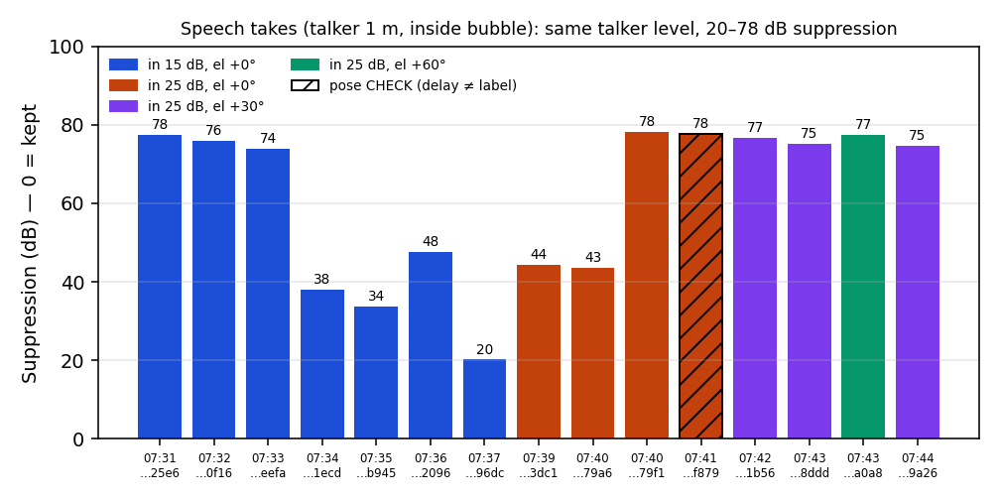
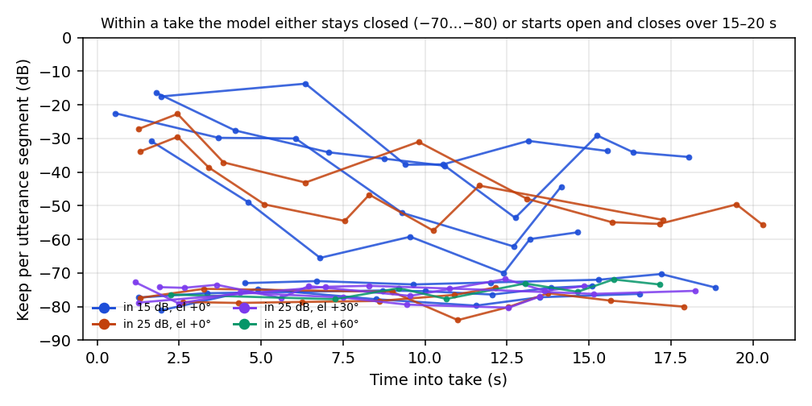
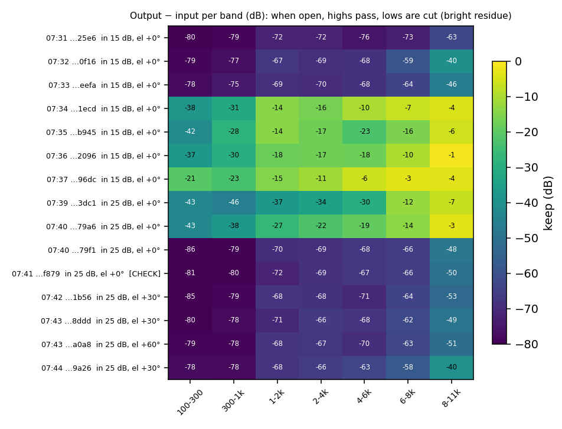

# Speech (in_context_speech) algorithm takes — EP35 on the bench

**Date:** 2026-11-04 (07:31–07:45 UTC)
**Run:** `measure/run_20261104_073046_3447eb` (Algorithm tab, campaign `in_context_speech`)
**Results/figures:** `measure/run_20261104_073046_3447eb/analysis/speech_eval_20261104/` · `docs/img/speech_ep35_20261104/`
**Related:** `docs/polar_sweep_1m_ep35_20261104.md` (ESS polar + recurrent-state observation) · `docs/mic_low_state_investigation_20261104.md` (mic levels)

> **Follow-up:** full speech × elevation × distance run with offline fresh-state comparison: [docs/speech_elevation_tests_ep35_20261104.md](speech_elevation_tests_ep35_20261104.md).

## Summary

- **15 speech takes** of a talker at **1 m, azimuth 0°, inside the 1.5 m bubble**, at elevations 0° (10), +30° (3) and +60° (1), plus one take at an unclear pose. Each take played a fresh random LibriSpeech loop of 3–5 utterances (about 15–20 s).
- **EP35 is bimodal:** it is either **closed** (74–78 dB suppression, flat for the whole take) or **open, then closing** (starts at −14…−34 dB keep and loses 16–29 dB within 15–20 s).
- **The mode switches between takes with no change in the input**, consistent with the recurrent-state dependence found with the ESS.
- **When open, the residue is bright:** 6–11 kHz passes at −1…−16 dB while 100–300 Hz is cut by −21…−43 dB. That matches the operator's report of high-frequency artifacts with no fidelity.
- **Elevation can't be judged from these takes:** all +30°/+60° takes fell in a closed period (75–77 dB), the same as the closed 0° takes.
- **Hotter input doesn't help:** +25 dB input gain (model input about +5 dBFS) didn't help. In its open phase, the voice band (1–4 kHz) kept −22…−37 dB, against −11…−18 dB at +15 dB.
- **Conclusion:** on this hardware EP35 does not reliably keep an in-bubble talker. Its behaviour is dominated by internal state, not source position. The next step is model-side: state-robust training on long or stateful sequences.

## Setup

| Item | Value |
|---|---|
| Model | `edge/zoo/optim_sonitude_dist_count_1_5m_ep35.onnx`, bubble 1.5 m, map `5,4,3,2,1,0` |
| Mic gains (dev ch 0…5) | ×1.514, 1.514, 6.457, 1.514, 1.514, 6.683 (wideband-only calibration; dev 4 normal in every take, dev4−dev0 −1.2…+0.2 dB) |
| Input gain (actual) | **+15 dB** for takes up to 07:37; **+25 dB** from 07:39 (pipeline restarted) |
| Model input (dry) | −3.7…−4.9 dBFS at +15 dB; **+5.0…+6.2 dBFS** at +25 dB (operating point −19 dBFS) |
| Talker level at mic dev 0 | −20.4…−21.7 dBFS raw (identical in all takes) |
| Stimulus | random utterance loop from `datasets/LibriSpeech/dev-clean`, levelled to −26 dBFS active RMS per utterance, saved per take as `stimulus_used.wav` (utterance list in `trial.json` → `stimulus_speech`) |
| Integrity | All 15 takes: taps intact, exit 0, **0 underruns** |

### Data-quality corrections

- **Mislabelled input gain:** the takes labelled "input25db" up to 07:37 (`eefa`, `1ecd`, `b945`, `2096`, `96dc`) actually ran at **+15 dB**. The live pipeline had been started at +15 dB and Setup edits don't reach a running pipeline; their dry and raw levels match the +15 dB takes exactly. `trial.json` → `gains.input_gain_db` is corrected to 15, with the original value and evidence in `settings_mismatch`.
- **Pose check, `074106_f879`:** labelled el 0°, but its top-of-arc mic delay is **−0.125 ms** (0° ≈ +0.02, +30° ≈ −0.21 ms), so the source sat somewhere between 0° and +30° (rig probably moving). It's flagged **CHECK** and shouldn't be counted as 0°.
- **Stale note, `074328_a0a8`:** the note says "30deg", but metadata and delay (−0.333 ms) confirm **+60°**. The note carried over from the previous take.
- **Earlier folders without a speech loop:** `run_20261104_040645_1abaf4/algorithm_20261104_071659_da04` and `run_20261104_072707_ab3a48/algorithm_20261104_072751_4706` were taken before the speech fix was loaded (no `stimulus_speech`). They're excluded. `072707_d1ba` and `073046_50f2` are empty folders.

## Results

| Time | Take | El | Input gain | Suppression (dB) | Keep 1–4 kHz | Keep 8–11 kHz | Trend within take | Mode |
|---|---|---:|---:|---:|---:|---:|---:|---|
| 07:31 | `25e6` | 0° | 15 | 77.5 | −72 | −63 | +4.9 | closed |
| 07:32 | `0f16` | 0° | 15 | 75.9 | −67…−69 | −40 | +3.5 | closed |
| 07:33 | `eefa` | 0° | 15 | 73.8 | −69…−70 | −47 | −1.4 | closed |
| 07:34 | `1ecd` | 0° | 15 | 38.1 | −14…−16 | −5 | **−19.1** | open → closing |
| 07:35 | `b945` | 0° | 15 | 33.6 | −14…−17 | −6 | **−21.7** | open → closing |
| 07:36 | `2096` | 0° | 15 | 47.6 | −17…−18 | −1 | **−27.0** | open → closing |
| 07:37 | `96dc` | 0° | 15 | **20.2** | −11…−15 | −4 | **−16.1** | open → closing |
| 07:39 | `3dc1` | 0° | 25 | 44.3 | −34…−37 | −7 | **−28.6** | open → closing |
| 07:40 | `79a6` | 0° | 25 | 43.5 | −22…−27 | −3 | **−20.3** | open → closing |
| 07:40 | `79f1` | 0° | 25 | 78.2 | −69…−70 | −48 | −2.6 | closed |
| 07:41 | `f879` | *check* | 25 | 77.7 | −69…−72 | −50 | +4.4 | closed |
| 07:42 | `1b56` | +30° | 25 | 76.8 | −68 | −53 | −4.3 | closed |
| 07:43 | `8ddd` | +30° | 25 | 75.2 | −66…−71 | −49 | +0.3 | closed |
| 07:43 | `a0a8` | +60° | 25 | 77.4 | −67…−68 | −51 | +3.0 | closed |
| 07:44 | `9a26` | +30° | 25 | 74.7 | −66…−68 | −40 | +3.4 | closed |

"Trend" is the keep of the last utterance segment minus the first.

## Observations

1. **Two regimes, switching between takes.**
   - *Closed* (8 takes): suppression 74–78 dB, every utterance −70…−84 dB, flat within the take. The in-bubble talker is effectively deleted.
   - *Open → closing* (6 takes): the first utterance is kept at −14…−34 dB, and by the end of the take keep has fallen by 16–29 dB (to −35…−70 dB).
2. **Neither input nor talker explains the switch.** Talker level at the mics is identical (−20.4…−21.7 dBFS) in all takes, and the utterances are random. The sequence closed ×3 → open ×4 → (restart at +25 dB) open ×2 → closed ×6 matches the recurrent-state dependence seen with the ESS (same input gives 37–73 dB depending on history; see the polar doc).
3. **The model closes progressively while streaming.** Within open takes, keep degrades steadily over 15–20 s, in line with the ESS observation that the live residual floor rises with streaming history.
4. **The pipeline restart (fresh state) briefly reopened it.** The first two takes after the +25 dB restart were open; the model was closed again by the third (about 2 minutes later).
5. **The open-phase output is spectrally tilted.** 6–11 kHz is kept at −1…−16 dB while 100–300 Hz is cut by −21…−43 dB. So even when it's open, what passes is mostly the highs: thin, bright, artifact-like. This matches the operator's listening report.
6. **Hotter input is worse.** At +25 dB (model input about +5 dBFS, roughly 24 dB above the −19 dBFS point), open-phase voice-band keep is −22…−37 dB, against −11…−18 dB at +15 dB. Stay at +15 dB.
7. **There's no elevation information here.** The +30°/+60° takes all happened during a closed period (75–77 dB, the same as closed 0° takes). Re-take elevation right after a pipeline restart, interleaved with 0° references.
8. **Technically clean:** 0 underruns, dev 4 normal, mic gains correct. The variability comes from the model, not the rig.

## Recommendations

- **Measuring EP35:** restart the pipeline before every speech take (fresh state), take each pose ≥ 3×, and interleave 0° references. Report the first-utterance and end-of-take keep separately as well as the overall figure. Keep input gain at +15 dB.
- **Testbench:** restart the pipeline after changing gains or model. Live takes now record the settings of the **running** pipeline, plus a `settings_mismatch` block and a take-log warning when Setup differs (`tools/measure/core.py`, `PipelineSession.launch`; needs a testbench restart to take effect).
- **Model:** the speech results confirm the ESS findings. EP35 needs **state-robust training** (long or stateful sequences, carrying state across clips) before further bench tuning pays off. A runtime mitigation (periodic state refresh using two staggered model instances with a crossfade) could be prototyped meanwhile.

## Data

| Path | Content |
|---|---|
| `measure/run_20261104_073046_3447eb/algorithm_20261104_*/` | 15 speech takes: raw_8ch, mapped_6ch, dry_ref, wet_out, `stimulus_used.wav` (the exact speech loop), `trial.json` (utterance list, corrected gains), `pipeline.log` |
| `…/analysis/speech_eval_20261104/results.json` / `.csv` | Per take: levels, actual gain, suppression, 7-band keep, per-utterance keep and onsets, trend, top-mic delay and pose check, dev4−dev0, utterance files |
| `…/analysis/speech_eval_20261104/figures/` | Figures 01–03 (also in `docs/img/speech_ep35_20261104/`) |
| `…/analysis/speech_eval_20261104/speech_eval.py` | Script to reproduce (writes new files only) |
