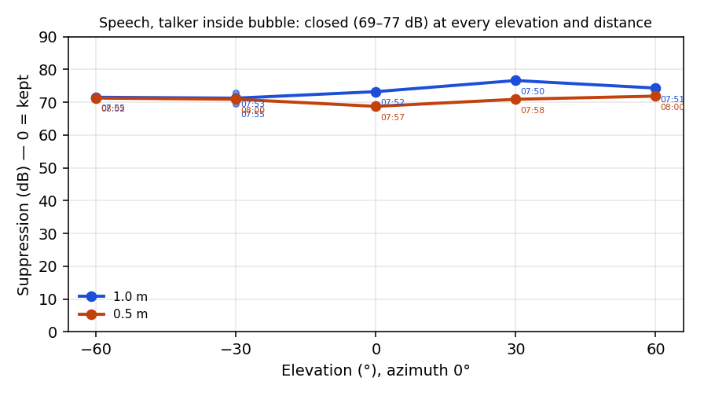
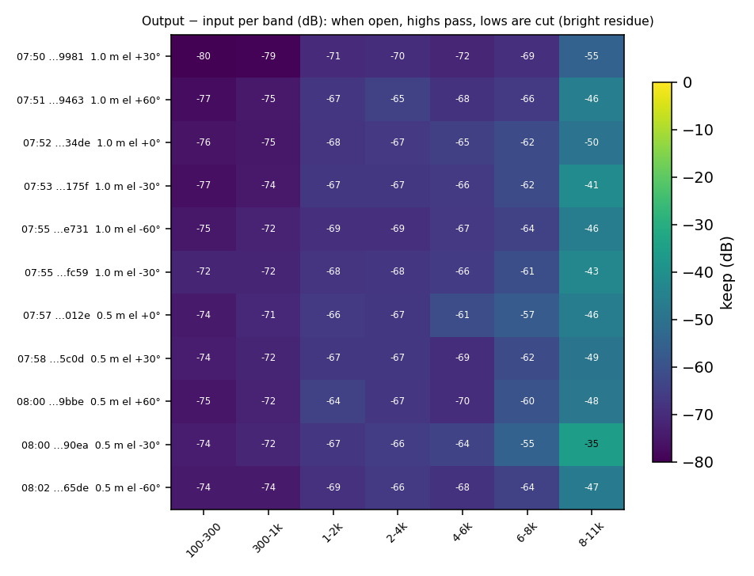
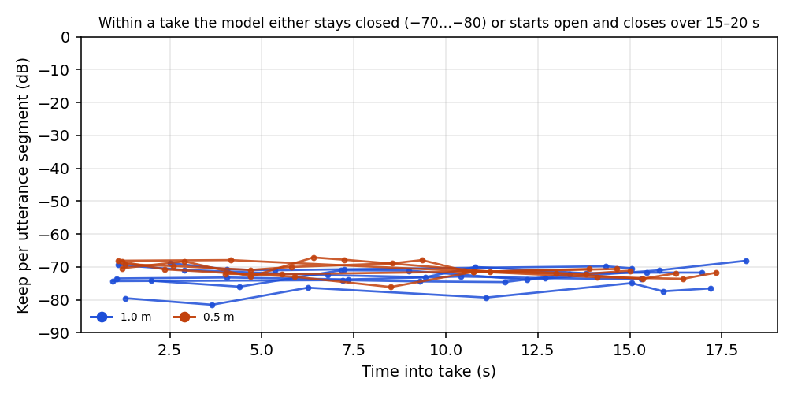
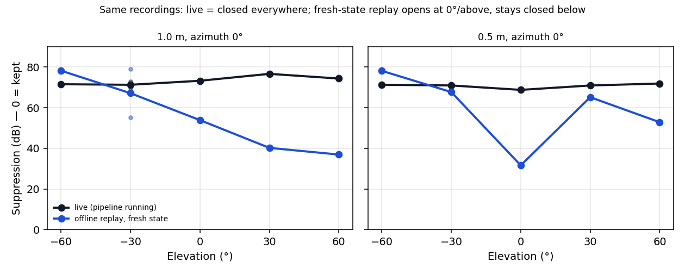
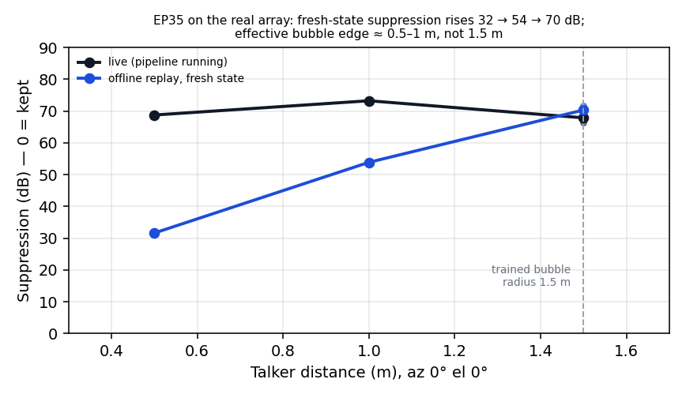

# Speech × elevation × distance test — EP35 (run_20261104_075009_b48fe6)

**Date:** 2026-11-04, 07:50–08:02 UTC
**Run:** `measure/run_20261104_075009_b48fe6` (Algorithm tab, `in_context_speech`)
**Analysis:** `measure/run_20261104_075009_b48fe6/analysis/speech_elev_eval_20261104/` · figures in `docs/img/speech_elev_ep35_20261104/`
**Related:** `docs/speech_algorithm_tests_ep35_20261104.md` (earlier speech takes) · `docs/polar_sweep_1m_ep35_20261104.md` (ESS polar, recurrent state, wideband mic correction) · `docs/mic_low_state_investigation_20261104.md`

## Summary

- **14 speech takes** (11 + 3 at 1.5 m, see the addendum), azimuth 0°, inside the 1.5 m bubble: **1 m** at +30, +60, 0, −30, −60 and −30 (repeat), then **0.5 m** at 0, +30, +60, −30, −60. Each take played a fresh random LibriSpeech loop of 3–5 utterances.
- **Live, EP35 was closed at every pose:** 68.8–76.6 dB suppression, flat within each take (trend −3.6…+6.0 dB), with no "open" take at all. The talker was effectively deleted even at **0.5 m, straight ahead**.
- **The pipeline had been restarted only 26 s before the first take** (07:50:07 vs 07:50:33), so a fresh start did not keep the model open in live use.
- **An offline replay of the same raw recordings from a fresh model state behaves very differently:**
  - The model **opens at 0° and upward**: 1 m, +30° 40 dB (keep −10…−29 dB, fairly flat); 1 m, +60° 37 dB; 0.5 m, 0° **32 dB** (2–11 kHz −4…−14 dB).
  - It **stays closed below the array**: −60° is 78 dB at both distances; −30° is 55–79 dB.
- **Interpretation:** live, the ~26 s of room noise during pipeline warm-up (plus any quiet gap between takes) is enough to drive EP35 into its **closed state**, and the arriving talker does **not** reopen it. That matches the earlier ESS finding that a room-noise or silence pre-roll makes EP35 more suppressive. In a continuously running product this is fatal: after any quiet period the in-bubble talker is muted.
- **What this run says about elevation:**
  - *Live:* no elevation information (closed everywhere).
  - *Fresh state:* EP35 favours sources **level with or above** the array and rejects sources **below** it (−60° is always closed), consistent with the earlier ESS elevation notch.

## Setup and data quality

| Item | Value |
|---|---|
| Model | EP35 `optim_sonitude_dist_count_1_5m_ep35.onnx`, bubble 1.5 m, map `5,4,3,2,1,0` |
| Pipeline | started **07:50:07 UTC** (`soundbubble-rt` start time), launch `--input-gain-db 15 --mic-gains 1.514,1.514,6.457,1.514,1.514,6.683`; output gain 10 dB (DAC only; taps are pre-gain) |
| Mic state | dev 4 normal in every take (dev4 − dev0 −1.1…+1.4 dB), so the calibrated gains are correct |
| Model input (dry) | 1 m: −3.5…−6.6 dBFS · 0.5 m: −1.7…+0.1 dBFS |
| Integrity | All 11 takes: exit 0, taps intact, **0 underruns** |
| Pose check | Top-of-arc mic delay, **ordering test** (each take within 0.06 ms of its pose group, group medians decreasing with elevation): **passes at both distances**. 1 m: +0.333 / +0.25 / +0.021 / −0.25 / −0.375 ms for −60…+60°; 0.5 m: +0.312 / +0.208 / −0.042 / −0.292 / −0.375 ms |
| Notes | The −30° takes match the mirror of +30° (±0.25 ms). The **+0.125 ms "−30°" reference from the relabelled ESS take** (`054213_5f85`) looks low, i.e. that ESS take probably sat between −30° and 0°. Treat that one point with care. |

## Results

### Live (as recorded)

| Time | Take | Dist | El | Suppression (dB) | Keep 1–4 kHz | Keep 8–11 kHz | Trend within take |
|---|---|---:|---:|---:|---:|---:|---:|
| 07:50 | `9981` | 1.0 | +30 | 76.6 | −70…−71 | −55 | +3.1 |
| 07:51 | `9463` | 1.0 | +60 | 74.3 | −65…−67 | −46 | +2.1 |
| 07:52 | `34de` | 1.0 | 0 | 73.2 | −67…−68 | −50 | +6.0 |
| 07:53 | `175f` | 1.0 | −30 | 72.9 | −67 | −41 | −0.2 |
| 07:55 | `e731` | 1.0 | −60 | 71.5 | −69 | −46 | −2.2 |
| 07:55 | `fc59` | 1.0 | −30 | 69.6 | −68 | −43 | −1.7 |
| 07:57 | `012e` | 0.5 | 0 | 68.8 | −66…−67 | −47 | −0.2 |
| 07:58 | `5c0d` | 0.5 | +30 | 70.9 | −67 | −49 | −3.6 |
| 08:00 | `9bbe` | 0.5 | +60 | 71.9 | −64…−67 | −48 | −2.2 |
| 08:00 | `90ea` | 0.5 | −30 | 70.9 | −66…−67 | −35 | −1.9 |
| 08:02 | `65de` | 0.5 | −60 | 71.3 | −66…−69 | −47 | +0.1 |

### Offline replay, fresh state (same raw recordings, gains, map and model)

| Dist | El | Live (dB) | **Offline fresh (dB)** | Offline keep per band 100-300 … 8-11k (dB) |
|---:|---:|---:|---:|---|
| 1.0 | +60 | 74.3 | **36.9** | −16 −23 −26 −24 −28 −34 −29 |
| 1.0 | +30 | 76.6 | **40.2** | −25 −29 −16 −11 −14 −10 −9 |
| 1.0 | 0 | 73.2 | 53.9 | −31 −30 −48 −47 −36 −39 −45 |
| 1.0 | −30 | 72.9 / 69.6 | 79.0 / 55.3 | −85 … −64 / −31 −33 −53 −51 −65 −70 −62 |
| 1.0 | −60 | 71.5 | 78.2 | −82 −78 −76 −76 −77 −74 −64 |
| 0.5 | +60 | 71.9 | 52.9 | −48 −44 −33 −23 −29 −23 −32 |
| 0.5 | +30 | 70.9 | 65.2 | −45 −45 −38 −37 −37 −48 −47 |
| 0.5 | 0 | 68.8 | **31.6** | −36 −23 −24 −14 −6 −8 −4 |
| 0.5 | −30 | 70.9 | 67.7 | −70 −51 −43 −60 −70 −67 −58 |
| 0.5 | −60 | 71.3 | 78.1 | −63 −65 −75 −72 −76 −77 −69 |

## Observations

1. **Live EP35 was uniformly closed (69–77 dB)** at all elevations and both distances, including 0.5 m straight ahead. The small spread drifts with time (76.6 → 69.6 dB across the 1 m series) more than with pose, so live gives no elevation or distance information.
2. **A fresh pipeline start does not keep the model open in live use.** The pipeline was 26 s old at the first take, and that take was already closed. (In the earlier run, the two takes right after a restart were open; that didn't reproduce here.)
3. **From a fresh state, the same audio is handled very differently.** Offline suppression ranges from 32 to 79 dB with a clear elevation pattern. That isolates the live closing to **state accumulated before and during the take**, not the acoustics or the hardware.
4. **The likely trigger is quiet periods.** Warm-up and between-take room noise precede every live take. The earlier ESS analysis showed that room-noise or silence pre-rolls push EP35 towards suppression (60 s room noise gave 72.5 dB vs 59.9 dB fresh). Speech arriving afterwards doesn't reopen it.
5. **Fresh-state elevation response:** sources level with or above the array are kept best (1 m: +60° 37 dB, +30° 40 dB, 0° 54 dB; 0.5 m: 0° 32 dB). Sources **below** are rejected (−60° 78 dB at both distances; −30° 55–79 dB). This matches the earlier ESS elevation notch and shows that the model treats "below the array" like "outside the bubble".
6. **Repeatability is still limited:** the two 1 m −30° takes give 79.0 vs 55.3 dB offline, even from a fresh state.
7. **The residue is still bright:** live, the 8–11 kHz residue (−35…−55 dB) is 20–40 dB above the 100–300 Hz residue (−72…−80 dB).
8. **The rig is clean:** 0 underruns, correct mic calibration, consistent poses. The failure is in the model's behaviour.

## Implications and recommendations

- **Product risk:** with a continuously running EP35, any quiet period can lock the model closed so that an in-bubble talker is muted. That's a functional failure, not just an artifact.
- **Measurement:**
  - Live single-take numbers mainly reflect model state.
  - For model or pose comparisons, use **offline fresh-state replay of the raw takes** (`speech_offline_replay.py`), alongside live takes for user-experience checks.
  - If live is required, start the stimulus immediately after a pipeline restart and log the time since start.
- **Model (priority):**
  - Train for state robustness: long or stateful sequences that include quiet gaps followed by in-bubble speech (so the model learns to reopen), carrying state across clips.
  - Add **below-array (negative elevation) in-bubble positives** to the training data.
  - Interim runtime idea: periodic state refresh via two staggered model instances with a crossfade, or a state reset on voice-activity onset.

## Addendum: 1.5 m takes and the real-array bubble edge (08:16–08:18 UTC)

**Takes:** 3 speech takes at **1.5 m, az 0°, el 0°**, in the same run:
- `algorithm_20261104_081608_4ca6` (note "neg60deg-0.5m" is stale; position confirmed below)
- `081711_735d`
- `081748_e121`

**Pipeline:** restarted at **08:17:43 UTC**, between take 2 and take 3, so take 3 started about 5 s after a fresh start.

**Data quality:**
- Pose checks pass: top-mic delay 0.0 ms, consistent with 0° el.
- Raw mic-0 level is −22.0…−22.5 dBFS (1 m: −21.4; 0.5 m: −18.4).
- dev 4 normal, 0 underruns, input +15 dB.
- Analysis: `analysis/speech_1p5m_eval_20261104/` (the live re-run with all takes, plus a fresh-state `offline_replay.json` covering the whole run).

| Take | Live suppression (dB) | Offline fresh (dB) | Live keep 1–4 kHz | Trend within take |
|---|---:|---:|---:|---:|
| `4ca6` | 68.7 | 69.6 | −61…−64 | +4.2 |
| `735d` | 66.3 | 71.7 | −58…−61 | −0.9 |
| `e121` (5 s after restart) | 68.6 | 69.6 | −63…−65 | +2.0 |

**Distance curve at az 0°/el 0°** (offline fresh state; live in brackets):

| Distance | 0.5 m | 1.0 m | 1.5 m |
|---|---:|---:|---:|
| Suppression | **31.6 dB** (68.8) | **53.9 dB** (73.2) | **70.3 dB** mean (67.9) |

**Observations:**
1. **1.5 m is closed both live and from a fresh state** (66–72 dB). Unlike 0.5 m and 1 m, a fresh start doesn't open it. The take that started 5 s after a pipeline restart was closed too.
2. **On the real array, EP35's effective bubble edge is about 0.5–1 m, not the trained 1.5 m.** Fresh-state suppression climbs steadily from 32 dB (0.5 m) to 54 dB (1 m) to 70 dB (1.5 m). On the synthetic distance sweep the trained edge sits between 1.5 and 2.0 m.
3. **Distance is being judged from spatial and reverb cues, not level.** The mic level changes only 0.8 dB from 1 m to 1.5 m (room reverb), so the model's distance decision rests on inter-mic and direct-to-reverberant cues, which on this array and room don't match training.
4. **The 1.5 m residue is still bright:** live 8–11 kHz keep is −52…−61 dB, against −73…−79 dB at 100–300 Hz.

**Do az/el measurements at 1.5 m add value now?**
- **Not with EP35.** Straight ahead is its most favourable direction (off-axis was worse at 1 m), and 1.5 m is already closed there from a fresh state. A ring at 1.5 m would mostly read "closed everywhere".
- **Higher priority: a distance ladder at az 0°/el 0°** (0.5, 0.75, 1.0, 1.25, 1.5, **2.0, 3.0 m**), to locate the real edge. **No out-of-bubble (2–3 m) recordings exist yet**, so far-talker rejection, the core function, is untested on the real array.
- **Recordings stay useful:** raw 8-channel takes are model-independent and can be replayed offline from a fresh state through any future model (v2 and later). A geometry grid recorded once is reusable.
- **Later edge characterization**, once a model keeps 1 m reliably: a sparse grid (az 0/90/180/270, el ±30) at 1.25, 1.5 and 2.0 m, ≥ 3 takes per pose.

## Data (new files in this run's `analysis/`)

| Path | Content |
|---|---|
| `speech_elev_eval_20261104/results.json` / `.csv` | Live per take: levels, gains, suppression, 7-band keep, per-utterance keep and onsets, trend, top-mic delay and pose check, dev4−dev0, utterances |
| `speech_elev_eval_20261104/offline_replay.json` | Offline fresh-state replay: suppression and 7-band keep per take, with the live value |
| `speech_elev_eval_20261104/figures/01…05_*.png` | Figures (also in `docs/img/speech_elev_ep35_20261104/`) |
| `speech_elev_eval_20261104/speech_eval.py`, `speech_offline_replay.py` | Scripts (run: `python debug/speech_eval.py run_20261104_075009_b48fe6 speech_elev_eval_20261104 speech_elev_ep35_20261104 --order-pose-check --by-distance`; `python -I debug/speech_offline_replay.py run_20261104_075009_b48fe6 speech_elev_eval_20261104`) |
| `speech_1p5m_eval_20261104/` | Re-run incl. the 3 × 1.5 m takes: live `results.json`/`.csv`, fresh-state `offline_replay.json` (all 14 takes), figures incl. `06_distance_0deg_live_vs_fresh.png`, scripts |
| `algorithm_20261104_*/` | 14 takes (11 + 3 at 1.5 m): raw_8ch, mapped_6ch, dry_ref, wet_out, `stimulus_used.wav`, `trial.json` (utterances), `pipeline.log` |
