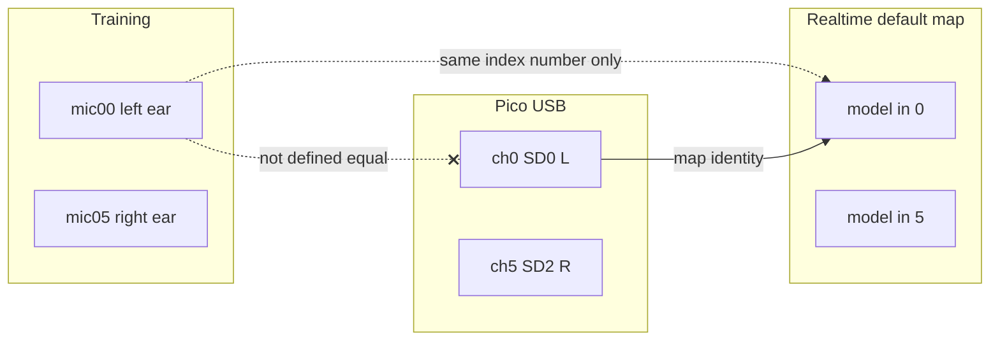

# Lecture hall leakage — focused fault audit

**Audit date:** 13 October 2026  
**Last status update:** 14 October 2026 (A2/A3/B8/B7 fixed; B4 software OK; B5 open + owner canon; Pico firmware vendored under `firmware/`)  
**Scope:** Faint or audible far-field speech (e.g. lecture / PA) while the Sound Bubble pipeline is running on the Pi headset rig.  
**Symptom framing:** “Feeble” voice may mean failed suppression, bypassed audio, or physical leakage past the earcups—not necessarily a single root cause.

**Worktree for realtime fixes:** `Sound_Bubble-worktrees/fixes` (branch `feat/realtime-fault-fixes`, PR #8). Sync to the Pi with `run_pi_live_pipeline.ps1 -SyncCode` before expecting these fixes live.

**Related owner-only / agent-readonly docs:**
- Mic index canon (fill §4 to close B5): [`edge/MIC_INDEX_CANON.md`](MIC_INDEX_CANON.md)
- Pico firmware tree (design docs agent-readonly): [`firmware/mic-array-pico2w-usb6ch/`](../firmware/mic-array-pico2w-usb6ch/)

**Verification pass:** 13 October 2026, against PR #7 launcher + `edge/zoo/optim_pretrain_sonitude_dist_count_1_5m_ep36.onnx`, promoted sweep CSVs, and training metadata. ~~Struck-through~~ text is proven wrong or unsupported.

### Status at a glance (for continuing work)

| Status | IDs | Notes |
|--------|-----|-------|
| **Fixed in code** | A2, A3, B8, B7 | In `fixes` worktree / PR #8; sync to Pi; confirm `[model]`, silence −100, `input_sr=48000`, overload `silence_fill`. |
| **Owner action (B5)** | B5 | Indices differ train vs Pico; leave OPEN until you fill [`MIC_INDEX_CANON.md`](MIC_INDEX_CANON.md) §4 from tap probe. |
| **Tooling ready; needs Pi** | B5, B6 | `edge/tools/channel_probe.py` + `edge/rpi5/run_channel_probe.ps1`. |
| **Open — do next** | A1, B5, B6, B4, B9 | Leakage test, channel probe, measure layout, firmware gain. |
| **Open — model / data** | C11 (partial), C12, C13, C10 | After A1 and hardware path are clean. |
| **Repo note** | — | Pico firmware PR: [#9](https://github.com/derraan/Sonitude_SoundBubble/pull/9). |

### Verification / remediation summary

| Item | Result |
|------|--------|
| A1 earcup leakage | Not testable from code; **still open — leading remaining suspect** (sim far-field ~70 dB suppressed). |
| A2 dry audio | **Fixed.** CLI + controller defaults now match `lowlat`: `silence_fill` + `--mix-dry 0`. |
| A3 wrong model | **Fixed.** Zoo resolver skips `trained_epochs==0`, prefers count-head + highest epochs → ep36. Untrained contracts refused unless `--allow-untrained`. Launcher pairs `-Model` with `--contract-path`. |
| B5 channel order | **OPEN.** Train ≠ Pico index meaning; Pi default identity unproven. Canon (owner-only edits): [`edge/MIC_INDEX_CANON.md`](MIC_INDEX_CANON.md) — fill §4 after tap probe to close B5. |
| B6 channel sync | Structurally one PIO / shared clock — **unlikely**. Clap probe ready; residual risk = USB starvation recovery. |
| B7 sample rate | **Fixed on Pi side.** Defaults/`--input-sr` = 48000; preflight negotiates UAC2 rate; stream `samplerate` asserted. Pico offers/clocks 48 kHz (source audit). |
| B8 channel mute | **Fixed.** Launcher `-SilenceDbfs -100`; controller default `silence_dbfs=-100`. |
| B9 clip / level | **Confirmed** (clip path). Default gain 0; trained ~−25 dBFS — firmware gain still needed. |
| B4 mic layout | **Train/infer software: same vertical-arc canon.** Datasets match pairwise distances exactly. Inference has **no** geometry code — assumes hardware + `--channel-map` match mic00…mic05. Physical headset still unchecked. |
| C10 room size | **Confirmed** (training ~5–8×4–8 m floor, ceilings 2–4 m). |
| C11 PA near | **Partly wrong** — 2–3 m is strongly suppressed in sim; overhead / multi-speaker gaps remain. |
| C12 sim-only | **Confirmed** (`real: false`). |
| C13 echo | **Mostly confirmed** (boundary moves inward at high RT60); “real halls have more echo than sim” unsupported. |

---

## Impact ranking — remaining open work (highest → lowest)

Closed items kept for history but deprioritized. Re-rank when continuing after A3/B8/B7.

| Rank | ID | Fault | Status | Why |
|------|-----|-------|--------|-----|
| 1 | A1 | Headphone / earcup leakage | **Open** | Software cannot remove sound past the earcup; matches “feeble” with strong model output suppression. |
| 2 | B5 | Wrong channel order | **Open — confirmed risk** | Train indices ≠ Pico lane indices; default identity map is an unproven assumption. Tap → `-ChannelMap`. |
| 3 | B6 | Channels out of sync | **Open — probe ready; unlikely** | Clap cross-corr; fail ⇒ firmware `ovr` / re-flash. |
| 4 | B4 | Mic layout ≠ training | **Open (HW only)** | Software path consistent; measure physical array vs vertical-arc canon below. |
| 5 | B9 | Input level / gain + clip | **Open** | Raise Pico gain so input ~−30…−20 dBFS; avoid heavy software gain + clip. |
| 6 | C11 | PA / overhead / multi-speaker OOD | **Partial** | Distance-2–3 m claim disproven; overhead + multi-source remain. |
| 7 | C12 | Simulation-only | **Open** | Real headset finetune (paper path). |
| 8 | C13 | Echo softens boundary | **Open** | Hurts near speech more than far leakage. |
| 9 | C10 | Room scale OOD | **Open** | Large-hall sim / real data. |
| — | A2 | Dry fill / mix-dry | **Fixed** | CLI/controller/launcher defaults: `silence_fill` + `mix_dry=0`. |
| — | A3 | Wrong model (fixture) | **Fixed** | Zoo + untrained guard + contract path. |
| — | B8 | Mute below −50 dBFS | **Fixed** | Defaults / launcher now −100 dBFS. |
| — | B7 | Sample rate mismatch | **Fixed (Pi)** | Default capture 48 kHz + stream rate assert. |

**Next priority list (open only):**

**A1 → B5 → B6 → B4 → B9 → C11 → C12 → C13 → C10**

---

## A. The voice may never have gone through the model

### A1 — Sound leaking through the headphones — OPEN

Top remaining suspect for a “feeble” voice. The paper’s ~49 dB suppression was measured on the **model output**, not at the ear. Typical ANC ~20–30 dB at speech frequencies; PA at 75–85 dB can still leak.

- **Check:** Headset on, ANC on, pipeline stopped (or output muted). Same faint voice ⇒ leakage.
- **Fix:** Closed-back seal + ANC on. Software cannot fix earcup leakage.

### A2 — Raw microphone audio being played — FIXED (14 Oct 2026)

Previously only the stock `lowlat` launcher forced `silence_fill` + `--mix-dry 0`; CLI and controller still defaulted to **`dry_fill`**, so non-`lowlat` / controller runs could play dry mic under overload.

**Remediation (`fixes` / PR #8):**
- `inference_pipeline.py` `--overload-policy` default → `silence_fill`
- `controller/config.py` `PipelineConfig.overload_policy` → `silence_fill`
- `--mix-dry` already defaulted to `0.0` (unchanged)
- Docs (`INFERENCE_PIPELINE_ARGS.md`, `EDGE_RUNTIME.md`) updated; regression test locks the defaults

Opt-in: pass `--overload-policy dry_fill` if continuous dry fill is still desired for a demo.

### A3 — Wrong model loaded — FIXED (13 Oct 2026)

Previously: zoo alphabetical pick loaded `optim_count_distance_fixture_1_5m` (`trained_epochs: 0`).

**Remediation (realtime worktree):**
- `_resolve_zoo_model` drops `trained_epochs == 0`, prefers `count_head_trained`, then highest epochs → `optim_pretrain_sonitude_dist_count_1_5m_ep36`.
- Untrained contracts exit unless `--allow-untrained`.
- `[model]` log line prints file, epochs, radius, heads trained.
- Launcher: `-Model` also passes matching `--contract-path`.

- **Still check once after sync:** log `[model]` shows ep36 / trained epochs ≠ 0.

---

## B. Microphone signals are not what the model expects

### B4 — Microphone layout does not match training — OPEN (hardware only)

**Canonical geometry (vertical arc / headphone array), cm relative to array centre, channel order mic00→mic05:**

| Ch | Role (training intent) | x | y | z |
|----|------------------------|---|---|---|
| 0 | Left ear | −12.8 | −1.5 | 0.0 |
| 1 | Headband L-outer | −10.2 | 0.0 | 11.3 |
| 2 | Headband L-inner (top) | −3.8 | 0.0 | 16.9 |
| 3 | Headband R-inner (top) | 3.8 | 0.0 | 16.9 |
| 4 | Headband R-outer | 10.6 | 0.0 | 11.7 |
| 5 | Right ear | 13.1 | −1.5 | 0.7 |

Ear span ≈ **25.9 cm**; vertical arc height ≈ **16.9 cm**. Defined in `generate_adaptive_dataset.py` `get_random_mic_positions_headphone` (~288–295); identical table in `src/visualize_bubble.py` (~240–247). Position jitter (±2 cm) exists in the generator but is **commented out**. Scenes only randomize **yaw** + room placement.

**Train ↔ dataset consistency (verified 13 Oct 2026):** sampled metadata from `syn_1m`, `syn_1_5m`, and `syn_libri_1_5m_rt60` — all six pairwise mic distances match the canon (max error 0 cm); z-span 16.9 cm and ear span 25.91 cm fixed.

**Train ↔ inference software:** **same assumption, not re-specified.** Training loaders (`general_multisrc_dataset_with_perturbations`) take channels from `mic_config: ["mic00"…"mic05"]` in mixture order; they do not re-apply coordinates (distance GT uses voice–centre from metadata). The realtime pipeline / ONNX path has **no mic XYZ** — only `--channel-map` / contract `expected_channel_map` (device indices → model inputs 0…5). So inference is consistent **iff** the physical array is that vertical arc **and** channel order matches mic00…mic05 (see B5).

**Not the same as Pico README hardware:** firmware docs describe a DFRobot **6+1 ring** board (I2S lane packing), not this headband arc. B4 is therefore “does your built headset match the training arc?”, not a train/val code split.

- **Check:** Measure physical mic XYZ vs the table; run B5 tap so map aligns left-ear→ch0 … right-ear→ch5.
- **Fix:** Rebuild/mount to match the arc, or regenerate sims + retrain for the real layout.

### B5 — Wrong channel order — OPEN (confirmed: indices are not the same throughout)

Three different “channel i” meanings exist. They are **not** documented as equal.

#### 1) Training / datasets — geometric vertical-arc order

| Index | Name | Role (canon XYZ, cm) |
|-------|------|----------------------|
| 0 | mic00 | Left ear (−12.8, −1.5, 0) |
| 1 | mic01 | Headband L-outer (−10.2, 0, 11.3) |
| 2 | mic02 | Headband L-inner top (−3.8, 0, 16.9) |
| 3 | mic03 | Headband R-inner top (3.8, 0, 16.9) |
| 4 | mic04 | Headband R-outer (10.6, 0, 11.7) |
| 5 | mic05 | Right ear (13.1, −1.5, 0.7) |

`mixture.wav` channel *k* = mic0*k*. Train configs use `mic_config: ["mic00",…,"mic05"]`. The model’s input dim *k* is trained as that arc role.

#### 2) Pico firmware — I2S **lane** order (not ear/arc order)

USB frame packing (`main.c` ~1045–1052) after `decode_sample` (SD bit0→lane0, bit1→lane1, bit2→lane2):

| USB device ch | Source | Meaning in firmware |
|---------------|--------|---------------------|
| 0 | `sample_l[0]` | SD0, WS left slot |
| 1 | `sample_r[0]` | SD0, WS right slot |
| 2 | `sample_l[1]` | SD1, left |
| 3 | `sample_r[1]` | SD1, right |
| 4 | `sample_l[2]` | SD2, left |
| 5 | `sample_r[2]` | SD2, right |
| 6–7 | zero | padding |

There is **no** firmware comment mapping SD0-L → “left ear”. README hardware is a DFRobot **6+1 ring** board; lane↔silk-screen mic is board wiring, not the training arc table.

#### 3) Pi realtime — identity remap by default

- Default / contract: `expected_channel_map` / `--channel-map` = **`0,1,2,3,4,5`**
- Semantics: `model_input[i] = device_channel[map[i]]`
- So with the default map, the pipeline **assumes** USB ch0 ≡ training mic00 (left ear), USB ch1 ≡ mic01, … — **an unverified assumption**.
- Nothing in inference encodes XYZ; order alone carries geometry.

**Verdict:** Layout **geometry** is consistent in training (B4). **Indices are not the same** from Pico → model unless hardware wires the arc in training order onto SD0…SD2 L/R, **or** `--channel-map` remaps them.

**Canonical definition (owner-writable only):** [`edge/MIC_INDEX_CANON.md`](MIC_INDEX_CANON.md) — agents must not edit it. B5 stays **OPEN** until you fill §4 there from a tap probe and set launcher `-ChannelMap` to that string.

- **Check / tool:** `.\edge\rpi5\run_channel_probe.ps1 -SyncCode -Mode tap`
- **Fix:** You write the result into `MIC_INDEX_CANON.md` §4; then apply `-ChannelMap` from that string.

### B6 — Channels not recorded in sync — OPEN (probe ready; firmware likely OK)

One PIO SM, shared SCK/WS — not separate I2S buses. Residual: ~1-sample L/R slot offset; USB starvation recovery substituting last-good samples. Training `max_shift: 4`.

- **Check / tool:**  
  `.\edge\rpi5\run_channel_probe.ps1 -Mode clap`  
  Pass: all \|mean lag\| ≤ 1 ms, stable across 3 takes.
- **If fail:** Pico CDC `ovr` / `ovr_bytes`; re-flash committed UF2 (firmware tree had dirty uncommitted builds).

### B7 — Sample rate mismatch — FIXED on Pi (13 Oct 2026)

Pico firmware **offers and clocks 48 kHz** (exact at 192 MHz sysclk; boot default advertise is still 44.1 until the host SETs rate).

**Remediation (realtime worktree):**
- `DEFAULT_INPUT_SR` / controller `input_sr` → **48000**
- Preflight logs device default vs requested rate; `check_input_settings` at 48 kHz (UAC2 renegotiate)
- After open, `assert_stream_samplerate` fails if PortAudio bound a different rate

- **Still check after sync:** log `input_sr=48000` and `[audio] input stream samplerate=48000 Hz (ok)`. Avoid `-Preset baseline` (legacy 44.1).

### B8 — Single channels being muted — FIXED (13 Oct 2026)

Previously: rolling level < −50 dBFS zeroed the channel; quiet INMP441s (USB `>> 16`, no firmware gain) often sat under that.

**Remediation:** launcher `-SilenceDbfs -100`; controller `silence_dbfs` default −100. FAULT clip check (−1…0 dBFS) unchanged.

- **Still check after sync:** `--monitor` should not show frequent `silence` on live mics in quiet rooms.

### B9 — Input level too low, or clipped by gain fix — OPEN

Trained ~−25 dBFS. Software `--input-gain-db` then hard-clips. Prefer Pico firmware gain (same on all six) to ~−30…−20 dBFS.

---

## C. The lecture hall is unlike anything in training

### C10 — Rooms far bigger than training — OPEN

Training rooms: **5–8 m × 4–8 m**, ceilings **2–4 m**. Halls often 15–30 m.

### C11 — A PA speaker can count as “near” — PARTIAL

- ~~2–3 m is where suppression is weakest.~~ **Wrong for promoted model (sim):** ≥ 2.0 m → ~−96 dBFS out (~70 dB) across RT60 0.2–1.6 s.
- Still open: **overhead** sources (training heights ~0.96–2.03 m) and **multi-speaker same voice**.

### C12 — Trained only on simulated data — OPEN

No real headset finetune set (`real: false`). Paper used ~14 h real recordings.

### C13 — Boundary softens in echoey rooms — OPEN

High RT60 moves boundary inward (~1.0–1.3 m attenuated). ~~“Real halls have more echo than sim”~~ unsupported (train RT60 up to ~2.0 s). Hurts near speech more than far leakage.

### Fixes for C (when hardware path is clean)

1. 1 m model export/deploy — weak rationale vs PA at 2–3 m (already suppressed); still an option for a tighter bubble.
2. Mute when count = 0 — not implemented; val count ~0.67, risky.
3. New sim: large rooms, overhead PA, multi-speaker, long RT, quiet levels → fine-tune.
4. Real headset recordings + fine-tune (most effective for C12 / B4 / B9).

---

## Recommended diagnostic order (updated)

1. **Sync fixed realtime code** to Pi (`-SyncCode`). Confirm log: `[model]` = ep36, silence −100, `input_sr=48000`, stream samplerate ok, no chronic muted channels.
2. **A1 leakage test** — pipeline muted vs running.
3. **B5 tap + B6 clap** via `run_channel_probe.ps1` (Pi must be online).
4. **B4 / B9** — measure layout; raise firmware mic gain.
5. **Offline `arecord` → laptop** if far voice still leaks after the above.
6. **C** retraining / real data only after A/B are clean.

---

## C fixes vs impact (effort annotated)

| Effort | Fix | Impact note |
|--------|-----|-------------|
| Smallest | 1 m model export + deploy | Weak for PA-at-2–3 m (already suppressed at 1.5 m in sim). |
| Small | Mute when inside count = 0 | Not implemented; count accuracy ~0.67. |
| Large | New sim (big rooms, overhead PA, multi-speaker, long RT) | C10, C11 residual, C13; still bounded by C12. |
| Largest | Real headset recordings + finetune | C12 + hardware-specific B4/B9. |

---

## Code references

- Training room bounds: `generate_adaptive_dataset.py` ~640–645.
- Training mic layout (vertical arc cm): `generate_adaptive_dataset.py` ~288–295; mirrored in `src/visualize_bubble.py` ~240–247; datasets `syn_*` pairwise-match that table.
- Voice height near `MIC_HEIGHT`: `generate_adaptive_dataset.py` ~669–672.
- A3 zoo pick + untrained guard: realtime worktree `edge/inference_pipeline.py` (`_resolve_zoo_model`, `--allow-untrained`).
- B8 silence default: launcher `-SilenceDbfs`; `edge/controller/config.py` `silence_dbfs=-100`.
- B7 48 kHz: `DEFAULT_INPUT_SR` / controller `input_sr=48000`; `edge/realtime/audio_io.py` preflight + `assert_stream_samplerate`.
- B5/B6 probe: realtime worktree `edge/tools/channel_probe.py`, `edge/rpi5/run_channel_probe.ps1`.
- B5 index canon (owner-only): `edge/MIC_INDEX_CANON.md`.
- Pico firmware (vendored): `firmware/mic-array-pico2w-usb6ch/` (USB pack order in `examples/usb_microphone_array_6ch/main.c`; design docs agent-readonly).
- Promoted zoo artifact: `edge/zoo/optim_pretrain_sonitude_dist_count_1_5m_ep36.onnx` (in realtime worktree zoo).
